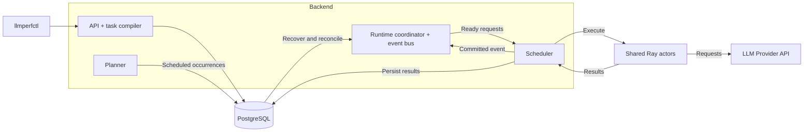

# llmperf-orchestrator

Reproducible LLM API load tests and KV-cache experiments, with durable scheduling,
configurable concurrency, and per-request results stored in PostgreSQL.

## Main features

- **Durable workloads:** submit individual Runners, scheduled rounds, or Campaigns;
  track their state independently of the CLI session.
- **Flexible concurrency:** a shared Ray actor pool serves independent requests across
  Runners; eight actors support 64 request slots by default.
- **Composable experiments:** combine sequences, parallel branches, repeats, delay
  matrices, and deterministic payload replay.
- **Multi-turn conversations:** pass committed message history between ordered invokes.
- **Performance evidence:** measure latency, throughput, errors, and available cache
  counters; export JSON and prepare HTML reports.
- **Controlled execution:** admission limits and runtime resource guards bound load;
  Provider credentials stay in Backend configuration.

Tokenization runs during prompt preparation. By default, output token counts come from
server usage; missing counts remain unavailable.

## Architecture



PostgreSQL holds metadata, checkpoints, results, and conversation history. The runtime
coordinator manages dependencies; Ray executes requests under the Scheduler's supervision.

## Quick start

Requires Python 3.10+, a running local PostgreSQL instance, and an LLM Provider API key.
The database commands assume your PostgreSQL role matches your login user and can create
databases. The example below uses Aliyun's OpenAI-compatible API.

### Install

```bash
git clone https://github.com/BeckWlim/llmperf-orchestrator.git
cd llmperf-orchestrator
python3 -m venv .venv
source .venv/bin/activate
python -m pip install -e .
createdb llmperf
psql -v ON_ERROR_STOP=1 -d llmperf -f sql/postgresql/init.sql
```

### Configure and start

```bash
llmperf-backend config set DATABASE_URL postgresql+asyncpg:///llmperf
cp src/llmperf_backend/configs/providers.example.yaml ~/.config/llmperf/providers.yaml
```

The copied file includes the Aliyun endpoint. Enter your API key without saving it in
shell history (Bash):

```bash
read -rsp 'Aliyun API key: ' ALIYUN_API_KEY; echo
printf '%s' "$ALIYUN_API_KEY" | \
  llmperf-backend config set LLMPERF_PROVIDER_ALIYUN_KEY --stdin
unset ALIYUN_API_KEY
llmperf-backend config set LLMPERF_DEFAULT_PROVIDER aliyun
llmperf-backend
```

Leave the Backend running. In another terminal, enter the same repository directory:

```bash
source .venv/bin/activate
llmperfctl config set LLMPERF_URL http://127.0.0.1:8000
llmperfctl health
llmperfctl provider list
llmperfctl provider models aliyun
```

For another Provider or Backend address, see the [configuration guide](docs/USAGE.md).

### Run and inspect

Open `examples/example-smoke.yaml` and set `benchmark.model` to an exact model ID from
the catalog above that your account can use. Then send one short request:

```bash
llmperfctl runner start -f examples/example-smoke.yaml --wait
llmperfctl runner list --limit 5
llmperfctl runner status RUNNER_ID
```

Use the Runner ID printed by the start command. A successful smoke test ends with
`succeeded`; use `llmperfctl runner logs RUNNER_ID` to diagnose a failure. The first run
may download the default tokenizer.

To run scheduled rounds, update the Provider/model in `examples/example-runner-plan.yaml`,
then submit and export a Campaign:

```bash
llmperfctl planner preview -f examples/example-runner-plan.yaml
llmperfctl campaign validate -f examples/example-runner-plan.yaml
llmperfctl campaign start -f examples/example-runner-plan.yaml
llmperfctl campaign status CAMPAIGN_ID
llmperfctl campaign export CAMPAIGN_ID -o results.json
```

Use the ID returned by `campaign start`. Add `--include-requests` to export individual
measurements, or use the [report skill](.codex/skills/generate-llmperf-report/SKILL.md)
to prepare an HTML report.

## Examples and documentation

- [Detailed usage and configuration](docs/USAGE.md)
- [Smoke test](examples/example-smoke.yaml) · [64-request load](examples/example-load64.yaml)
  · [Scheduled rounds](examples/example-runner-plan.yaml)
  · [Parallel Runner rounds](examples/example-rounds.yaml)
- [Cache retention](examples/example-cache-retention.yaml)
  · [Cache promotion](examples/example-cache-promotion.yaml)
  · [Long-context dataset](examples/example-sharegpt-long.yaml)
- [Architecture and concurrency](docs/ARCHITECTURE.md)
  · [Runtime and multi-turn usage](docs/RUNTIME.md)
  · [Task compiler](docs/TASK_COMPILER_ARCHITECTURE.md)
- [Configuration reference](.env.template) · [Provider file example](src/llmperf_backend/configs/providers.example.yaml)
- [systemd deployment](deploy/systemd/README.md) · [Testing](docs/TESTING.md)

Existing installations: the Backend checks required tables and columns. For older
database layouts, follow the [cutover guidance](docs/RUNTIME.md#recovery-and-cutover).

## Development

```bash
python -m pip install -e '.[dev]'
python -m basedpyright
pytest -q
```

## Credits and license

Built on [ray-project/llmperf](https://github.com/ray-project/llmperf).
Licensed under [Apache 2.0](LICENSE.txt).
