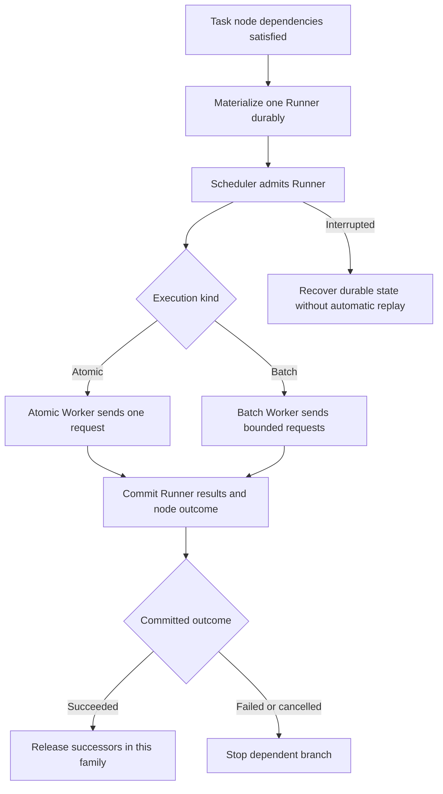

# Runner dispatch development plan

Status: implemented, validated, and deployed on 2026-10-15. This records the
Backend design originally requested for `test-dcu-11:/home/xffan2/llmperf-test/workloads/campaign.yaml`.

Make one workflow execution node dispatch one Runner. A Runner may execute a bounded
batch of requests, while the task workflow owns dependencies between Runners. This lets
each of eight workload families complete 100 rounds independently, with 256 requests and
concurrency eight in each round.

## Required behavior

```text
Campaign
├── Family 01: Runner 1 → Runner 2 → … → Runner 100
├── Family 02: Runner 1 → Runner 2 → … → Runner 100
└── Families 03–08: independent sequences with the same structure

Each Runner: 256 target requests, at most 8 requests in flight
Each arrow: predecessor succeeds and its results are durably committed
```

Family 01 may start round 2 while Family 02 is still executing round 1. A family has at
most one active Runner. Waiting nodes reserve no Worker or request capacity. Backend
capacity and other Campaigns may reduce actual concurrency below the offered maximum.

| Quantity | Target |
|---|---:|
| Task definitions | 1 |
| Task instances | 8 |
| Dispatch nodes per instance | 100 |
| Total dispatch nodes and eventual Runner executions | 800 |
| Maximum active Runners from this Campaign | 8 |
| Maximum concurrent requests from this Campaign | 64 |
| Target requests across successful full batches | 204,800 |

Materialize a Runner only when its node becomes eligible. The Campaign's `RUN` count
therefore grows during execution; `TASK=8` and `DISP=800` describe the accepted graph.
There are no RunnerPlans in this workload. Failed, cancelled, or interrupted execution
can leave fewer than 800 materialized Runners and fewer completed requests.

## Verified implementation boundaries

The existing task graph already supports `sequence`, `repeat`, and `parallel`.
`ExecutionNodeRecord` stores a Runner template, and `Repository.activate_node` emits a
Runner. The dependency coordinator already waits for a predecessor's successful result.

The one-request restriction appears at several boundaries:

| Location | Current restriction or responsibility |
|---|---|
| `src/llmperf_backend/task_compiler.py` | `TaskAssembler` forces request count and concurrency to one; payload seeds exclude repeat position |
| `src/llmperf_backend/models.py` | `CompiledBenchmarkConfig` validates exactly one request |
| `src/llmperf_backend/scheduler.py` | Presence of `task_context` selects `AtomicWorker` |
| `src/llmperf_backend/persistence.py` | Task result completion requires exactly one request result; replay and conversation handling assume atomic payloads |
| `src/llmperf_backend/runtime.py` | Readiness requires committed predecessor success; reuse this dependency boundary |
| `src/llmperf_backend/safety.py` | Task estimates must account for request counts and concurrency inside each Runner |

On the installed Backend, expressing every request as an atomic node requires 25,600
nodes per family and fails the 10,000-node instance limit. Batch dispatch reduces this to
100 nodes per family without raising that limit.

## Proposed YAML contract

Add a `run` primitive alongside the existing atomic `invoke`. Both compile to execution
nodes that dispatch a Runner. `run` inherits the task definition's `runner` template and
preserves its request count and concurrency. Existing `invoke` keeps its single-request,
payload replay, and conversation semantics.

The following is a proposed workflow fragment, not valid input for the installed release:

```yaml
task_definitions:
  - name: sharegpt-family-sequence
    instances:
      matrix:
        family: [1, 2, 3, 4, 5, 6, 7, 8]
      trials: 1
      seed: 20261014174544
    workflow:
      - repeat:
          name: rounds
          count: 100
          node:
            run:
              name: batch
    runner:
      benchmark:
        # Retain the existing Provider, model, tokenizer, dataset and token settings.
        max_completed_requests: 256
        concurrent_requests: 8
```

Define `run` with `name`, optional `role`, and `after_seconds`. Reuse the existing Runner
template instead of introducing template references or per-node benchmark overrides in
the first implementation. Permit absent `payloads` for workflows containing only `run`;
require every atomic `invoke` payload reference to resolve. Reject `conversation` and
atomic payload fields on `run`. Initially reject `cache_probe` on task batch templates,
preserving the existing task restriction until its completion semantics are designed.

Use an explicit internal execution kind, such as `atomic` or `batch`, throughout the
compiled node, resolved Runner context, persistence, and Worker selection. A batch with
one request remains a batch; the presence of task lineage must not imply atomic execution.
Keep internal kind and lineage fields Backend-owned and reject user-supplied overrides.

## Seeds and prompt families

For batch nodes, derive a deterministic dataset seed from the task seed, sorted instance
coordinates, trial index, and fully qualified logical node path, including repeat indices.
Version and persist this derivation. Derive it before assigning UUIDs so scheduling order,
restart, and runtime identifiers cannot change prompts.

Extend task input seed validation to accept the existing nonnegative 64-bit workload seed;
the current task seed limit is only 2,147,483,647. Do not change the legacy atomic payload
seed algorithm. Store the derived batch seed in the resolved Runner's `dataset_seed` and
use the ordinary dataset preparation path, rather than atomic exact-replay preparation.

Within a batch, retain the configured shared prefix and varying request suffixes. Across
family-round pairs, derive new seeds. Different seeds do not guarantee disjoint corpus
content. The generic task derivation will differ from the old `campaign.rounds` algorithm,
so converted workloads are reproducible under the new derivation but do not reproduce the
old prompts byte for byte. Test all 800 derived seeds for distinctness in this workload.

## Completion and recovery contract

This diagram describes the proposed execution path. Keep its Mermaid source editable.



Use the existing ordinary Runner outcome rules for batches; reaching a request target is
not a new task-specific success rule. Preserve timeout, partial-result, cancellation, and
error evidence. A timeout or partial batch may yield fewer requests than the configured
target, and estimates must remain labelled as targets.

Commit all available batch request records, Runner aggregate outcome, execution attempt,
node completion, and task checkpoint consistently before publishing successor readiness.
Keep request-level timestamps and hashes; do not represent a whole batch using the first
request's prompt hash or payload evidence. Dependency delays for a batch anchor to its
completion, never its first request. Preserve atomic timing and replay evidence behavior.

Retain idempotent activation, ownership fencing, and rejection of stale or duplicate
completion. Cancellation prevents further admission and successor release. A failed batch
blocks dependent nodes in its family while independent families may continue. Finalize
unreachable descendants so a failed family cannot remain pending indefinitely. Interruption
must not automatically resend a partially executed batch or infer successful completion.

## Implementation sequence

1. **Define the contract and compiler representation.** Add strict `run` input, explicit
   execution kind, batch context, seed derivation, and conditional payload validation.
   Preserve typed boundaries between raw input, validated recipes, compiled nodes, and
   resolved Runner templates. Extend the compilation table and assembler to preserve batch
   limits. Deliver parser and pure compiler tests before changing runtime behavior.

2. **Generalize execution and persistence.** Route batch task Runners through the ordinary
   batch Worker and shared request pool. Audit every use of `task_context`, including
   prompt preparation, request metadata, cancellation, attempt recording, replay checks,
   task status, recovery, and exports. Restrict one-result and conversation checks to atomic
   execution. Reuse the existing execution-node-to-Runner relationship and dependency
   coordinator; do not introduce a second dispatch queue.

3. **Make stored compatibility explicit.** Inventory whether execution kind can be stored
   in the existing frozen template/context or requires a column. Define legacy compiled
   task records as atomic without guessing from request count. If schema changes are needed,
   update SQLAlchemy, `sql/postgresql/init.sql`, readiness checks, a deliberate migration,
   and integration tests together. Record the chosen protocol/template version strategy;
   older Backends must reject the new primitive clearly. Preserve ordinary Runners,
   RunnerPlans, existing round Campaigns, atomic tasks, and multi-turn history.

4. **Update estimates and observable results.** Compute requests as the sum of each expanded
   Runner's request target. Compute peak active Runners and weighted request concurrency
   across sequences, repeats, parallel branches, and instances. Account for shared actors,
   active Runner bounds, and preparation resources. Update the safety validator, task
   preview, CLI/API response validators and projection whitelists, exports, and analysis
   readers that assume a task node means one request. Keep RUN/PLAN/TASK/DISP as object
   counts; expose request budgets separately and distinguish planned from materialized work.

5. **Verify and document the feature.** Add the acceptance cases below. Update
   `docs/TASK_COMPILER_ARCHITECTURE.md`, `docs/RUNTIME.md`, `docs/ARCHITECTURE.md`,
   `docs/RUNNER_PLANNER_ARCHITECTURE.md`, `docs/USAGE.md`, the README, and the relevant
   operate/report skill references. Add a short runnable example such as
   `examples/example-batch-sequence.yaml`; keep production-scale values in this plan or
   workload files rather than the quick example's defaults.

6. **Prepare the remote workload conversion.** After compatible Backend and CLI artifacts
   pass validation, back up the exact remote YAML and replace `campaign.rounds` plus eight
   templates with the proposed task definition. Preserve Provider/model, token settings,
   dataset/tokenizer revisions, request budget, seed provenance, and `wait: false`.
   Record the changed seed derivation and failure semantics in workload comments. Validate
   against the deployed schema and actual Scheduler capacity before declaring the file ready.

## Acceptance tests

| Area | Required evidence |
|---|---|
| Compiler | Eight instances and 800 batch nodes; 100-node chains; no dependencies across families; strict rejection of mixed or invalid node fields |
| Seeds | Deterministic derivation across compilation and restart; 800 distinct seeds for the supplied workload; legacy atomic replay seeds unchanged |
| Preparation | Shared prefix retained within a batch; suffix generation follows the ordinary concatenate path; batch lineage does not force exact replay |
| Scheduling | A fast family's next round starts while another family is still in its previous round; no overlapping rounds within one family |
| Capacity | At most eight active Runners and 64 executing requests for this Campaign; reduced capacity and competing Campaigns remain bounded and fair |
| Completion | A successor cannot start after just one request or before the batch result transaction commits; batch delay uses the correct completion anchor |
| Persistence | Multiple request results retain request indices, metrics, evidence, and aggregate outcome; duplicate and stale completion cannot release extra work |
| Failures | Partial batch, timeout, cancellation, Worker failure, and restart preserve outcomes; failed descendants terminate; unrelated families continue |
| Recovery | Restart after committed completion releases the successor once; restart during a batch does not replay uncertain requests |
| Compatibility | Atomic cache probes, conversations, ordinary batch Runners, RunnerPlans, and existing global round barriers retain their behavior |
| Estimates and CLI | 800 planned Runners, 204,800 target requests, peak eight Runners and 64 requests; counts and exports remain correct as Runners materialize |

Use pure compiler/runtime tests and fake Providers for scale and failure cases. PostgreSQL
integration tests must exercise transaction boundaries and recovery against an explicitly
configured test database. A small real-Provider smoke is a separate operational step.

Run focused tests in the existing compiler, runtime, storage, scheduler, Worker, safety,
preparation, and CLI suites, followed by the normal gates:

```bash
.venv/bin/python -m basedpyright
.venv/bin/python -m compileall -q src tests
.venv/bin/pytest -q
git diff --check
```

Report skipped PostgreSQL coverage explicitly. Follow the repository's stable-binding and
type-safety rules; do not hide incompatible execution types with `Any`, unchecked casts,
or type-ignore directives.

## Rollout and completion criteria

The feature is complete when the converted workload validates, all acceptance tests pass,
and observed small-scale execution demonstrates independent family progression with batch
results intact. Use a two-family, two-round, four-request smoke before a production load;
then validate the full 800-node graph without sending its requests.

Prepare release artifacts and an exact deployment/restart procedure before changing the
remote service. Review any required migration against the existing database and preserve
old workload/configuration backups. Do not reinterpret already submitted Campaigns.
Editing `campaign.yaml` affects future submissions only.

This development plan does not itself deploy a release, restart the Backend, migrate a
database, or submit Provider traffic. Rollout and the 204,800-request run require their own
execution scope. If a schema migration is introduced, document rollback compatibility
before deployment; do not assume replacing the binary reverses the migration.

## Deployment acceptance

Deployed to `test-dcu-11:/home/xffan2/llmperf-test` using image
`llmperf-internal:1.0.0-runner-dispatch-20261015`. The tested wheel was transferred
and the image built on the target because the agent could not access the local Docker
daemon. The image's 53 packaged source files match the release manifest.

- Full regression suite: 414 passed, 6 skipped; basedpyright: zero errors or warnings.
- Baseline Campaign `2075276e-e259-4160-b4d2-62fff0b8d138`: two families, two rounds
  each, two requests per Runner; four successful Runners and eight successful requests.
- Recorded timestamps confirm each family's second Runner started after its first
  completed; all four batch seeds differ. Keyless inference succeeded.
- Full workload preview: eight independent 100-round chains, 800 distinct seeds,
  204,800 requests, maximum concurrency 64. Artifacts validated; workload not submitted.
- Active workload files: `workloads/base-test.yaml` and `workloads/basic-pressure.yaml`.
  The latter replaces the original `campaign.yaml`; older YAML files were archived under
  `backups/before-runner-dispatch-20261015/retired-workloads/`.
- Original configuration, Compose file, workloads, and PostgreSQL dump remain in
  `backups/before-runner-dispatch-20261015/`; the existing database volume was preserved.
