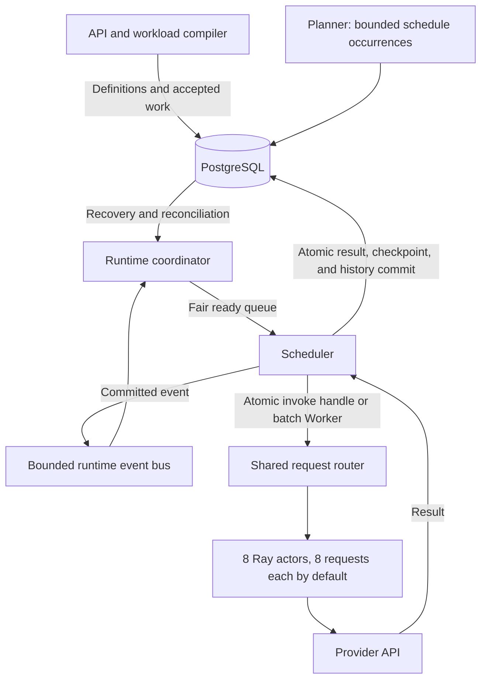

# Runtime, storage, and multi-turn execution

The Backend runs one runtime coordinator and one Scheduler. PostgreSQL stores accepted
work, execution intent, checkpoints, results, and message history. Runtime queues and Ray
actors manage live work. Tables live in the PostgreSQL schema selected by the connection
(normally `public`). There is no application schema-version marker. Readiness checks
required tables and columns; it does not validate every type, index, or constraint.
The previous protocol or Dispatch layout still requires a fresh database or an explicit
migration; changing a label cannot convert those tables.



The coordinator computes dependencies and due times from committed node progress.
Periodic reconciliation repairs missed wakeups and reconstructs the ready queue after a
restart. The bus is a bounded, coalescing in-process queue, not a second durable store.
Planner handles scheduled occurrences; it does not select ready task-graph nodes.

Task `run` nodes dispatch batch Runners through the ordinary Ray Worker; `invoke` nodes
use atomic Workers. The explicit `task_context.execution_kind` selects the path; missing
kind on legacy contexts means `atomic`. A batch retains all request metrics but advances
its node only after the aggregate outcome commits. Its dependency delay anchors to batch
completion, and its requests do not participate in atomic payload replay checks. Failed
or cancelled batches terminate their instance's remaining nodes; other instances continue.
Interrupted batches are not automatically replayed. Batch context and seed version live in
existing JSON records, so this addition requires no database migration; deploy a compatible
Backend before submitting `run` workflows, and drain such work before rolling back.

## Capacity

```text
actor count = floor((ray_num_cpus - preparation_workers) / ray_actor_num_cpus)
request capacity = actor count × ray_actor_max_concurrency
```

The runtime performance guard can lower that capacity. Ray CPU resources determine actor
placement, while request slots measure HTTP operations in flight. Default settings give
eight actors and 64 request slots. Different Runners can share an actor; credentials,
messages, metrics, and adapter objects are isolated per request. Actors never change their
process environment to switch Providers.

`LLMPERF_RUNNERS_MAX` independently bounds active logical Runner handles. Its default is
64 so 64 independent atomic invokes can occupy all request slots. An existing explicit
value of 8 remains a limit of eight simultaneous one-request Runners. Ordinary Runners can
each request multiple slots through `concurrent_requests`. The shared router fairly
rotates queued requests between Runners and enforces the global capacity across Campaigns.

```bash
llmperf-backend config set LLMPERF_RUNNERS_MAX 64
llmperf-backend config set LLMPERF_RAY_CPUS 8
llmperf-backend config set LLMPERF_RAY_ACTOR_CPUS 1
llmperf-backend config set LLMPERF_RAY_ACTOR_MAX_CONCURRENCY 8
llmperf-backend config set LLMPERF_MAX_RUNNER_CONCURRENCY 64
llmperf-backend config set LLMPERF_MAX_EFFECTIVE_CONCURRENCY 64
```

Apply settings before starting the updated Backend. Configuration does not submit work.
Scheduler status reports `live_slots` and `busy_slots` as request capacity and executing
requests, plus `active_runners` and `request_pool` details. Pool counts are sampled with Ray
health. Admission reports requested and effective concurrency separately when capacity
limits a workload.

Compiled invokes complete individually. There is no static group completion barrier.
Ready work shares actors at execution time, including requests from different instances.
Blocked turns, joins, and delays use no actor slot. Atomic invokes use lightweight local
Worker handles and a bounded thread executor; their HTTP requests execute in Ray actors.
Tokenizer objects are cached by resolved path and mode in the Backend, with serialized
initial loading. Ordinary batch Runners retain a Ray Worker task and use the same shared
request pool. Ray execution retries and actor restarts remain disabled.

## Durable records

| Tables | Purpose |
|---|---|
| `benchmark_campaigns`, `benchmark_runner_plans` | Ownership, recurrence, durable control intent |
| `benchmark_task_definitions`, `benchmark_task_instances` | Recipes, compiled instance metadata, checkpoints and outcomes |
| `execution_nodes` | Durable node identities, dependencies, completed timing, and Runner linkage |
| `benchmark_runners`, `task_attempts` | Logical execution status and fenced execution attempt |
| `benchmark_request_results` | Request metrics and history-version references |
| `conversation_messages` | Ordered immutable user/assistant content, scoped to an instance and conversation |
| `execution_leases` | Single active Backend owner, expiry and increasing fencing generation |
| Runner/plan event and identity tables | Lifecycle audit and authentication metadata |

`execution_nodes` replaces `benchmark_runner_dispatches`. Its pending/blocked fields
describe durable progress; SQL no longer decides graph readiness. Repository transactions
still verify payload identity and terminal state. Existing metadata table names remain
where their responsibilities are unchanged. Event tables remain purpose-specific audit
records, not a database message bus.

An attempt records one Runner execution: one request for compiled invokes, potentially
many for an ordinary batch. Batch request results commit at batch completion. If the
Backend loses a batch before its results commit, the attempt is indeterminate; the runtime
does not infer individual successes or retry the batch.

## Multi-turn YAML

Use the same `conversation` name on dependency-ordered invokes. Conversation identity is
scoped to a task instance, so trials have independent histories. A payload can provide
literal `text`, or use the existing deterministic generated-prompt configuration.

```yaml
payloads:
  first: {seed_namespace: first, text: "Remember ORCHID."}
  next: {seed_namespace: next, text: "Which word did I ask you to remember?"}
workflow:
  - invoke: {name: first, payload: first, conversation: chat}
  - invoke: {name: next, payload: next, conversation: chat}
```

See [the complete example](../examples/example-multiturn.yaml). Parallel branches must
use different conversation names unless dependencies order their writes. Implicit joins
and `after_seconds` work as before. VertexAI's single-prompt prediction adapter rejects
conversation workloads; chat-capable adapters accept message history.

On completion, one transaction commits metrics, user/assistant messages, history version,
and checkpoint. A successor sees only committed history. Duplicate completion cannot append
the same turn twice, and an unexpected parent version aborts the transaction. History is
loaded for execution without copying it into every persisted Runner configuration.
Campaign exports with request details include `conversation_messages`.
For conversation requests, `prompt_hash` identifies the current user payload;
`messages_hash` identifies the complete message list, and `history_version` identifies
its committed prefix. Repeated user text does not imply an identical full-history request.

The default token-count policy uses the tokenizer during prompt preparation and server
usage for response counts. Accumulated history is not retokenized. If the server omits
input usage for a conversation, full-history input counts remain unavailable. Local output
counting remains an explicit opt-in after timed execution.

## Parallel preparation and Runner rounds

Request slots belong to the shared router, not to individual Workers. Ready requests
from different Runners can share one actor; `concurrent_requests` remains each Runner's
ceiling. Preparation and dependency waits do not reserve request slots.

For eight preparation processes plus eight request actors, configure:

```dotenv
LLMPERF_RAY_CPUS=16
LLMPERF_PREPARATION_WORKERS=8
LLMPERF_RUNNERS_MAX=8
LLMPERF_RAY_ACTOR_CPUS=1
LLMPERF_RAY_ACTOR_MAX_CONCURRENCY=8
LLMPERF_PREPARATION_CHUNK_SIZE=16
LLMPERF_PREPARATION_BUFFER_CHUNKS=8
```

Each preparation actor reserves one Ray CPU. Request actor count uses the remaining
CPU budget, so enabling preparation does not increase request capacity accidentally.
Preparation defaults to zero workers for existing installations. With it enabled,
ordinary bundled-sonnet and external `concatenate` workloads calibrate corpus token estimates once per Runner,
then generate deterministic chunks without further tokenizer calls. Each Runner holds
at most `buffer_chunks` pending chunks and one consumed chunk; it does not build the
whole workload before sending. Results still accumulate until the Runner completes,
so Runner request counts must remain bounded. A single Runner can use the preparation
pool; eight Runners are not required to use eight preparation actors.

The local input length is a calibrated estimate, with provenance in `prompt_evidence`.
Provider usage remains authoritative. External datasets use the existing loader and
memory-mapped index. Calibration samples at most 128 records, capped at 4,096 characters
each. Preparation then selects from the full corpus without tokenizing requests or
copying the corpus into Ray messages. The resulting character/token estimate can vary
in accuracy across languages and records. Dataset choice is entirely in `benchmark.dataset`;
use `dataset_prompt_mode: concatenate` with `shared_prefix_tokens` for prefix workloads.
External `sample` workloads, cache probes, and compiled
exact-replay/multi-turn tasks retain their existing exact preparation path. Their
payloads are not silently converted to estimated prompts. Worker logs remain buffered
until completion; scheduler status displays preparation capacity separately.


One YAML can repeat a set of Runner templates:

```yaml
campaign:
  name: cache-pressure
  rounds: {count: 100, seed: 20261014}
runners:
  # Eight ordinary Runner templates, each concurrency 8 and request count 256.
```

The Backend resolves templates once, expands and assesses the entire budget, and
persists all Runners atomically. Seeds derive from the explicit seed, round, and
template index. Chunk boundaries and actor scheduling do not change prompt content.
All members of a round must become terminal before the next round is eligible.
Failures remain visible in Campaign outcome; independent later rounds may continue.
Cancellation stops the entire Campaign. Recovery reconstructs barriers from durable
Runner status and `metadata.runner_round`; no extra database schema is needed.
This metadata field is reserved for Backend round expansion.

Round boundaries may have preparation/ramp-down gaps. A finite round count is not a
wall-clock duration or guaranteed continuous occupancy. An 80% shared prefix describes
offered reuse, not an observed cache-hit ratio. See [example-rounds.yaml](../examples/example-rounds.yaml).

## Recovery and cutover

The lease admits one active Backend even with an external Ray cluster. A new owner receives
a higher generation; stale owners cannot commit results. Interrupted executing attempts
become indeterminate and fail their Runner. Accepted work that never started remains
recoverable. No automatic Provider retry is introduced. Fencing cannot undo an HTTP request
already sent. Cancellation prevents queued calls from starting, while a running call keeps
its physical slot until execution ends.

Completed results remain bounded by the active Runner limit while a transient database
write failure is retried. Successors remain blocked until commit. A lost runtime lease
requires recovery under a new owner; it does not permit the old owner to continue writing.

Create a fresh database, initialize it with `sql/postgresql/init.sql`, point `DATABASE_URL`
to it, and restart the Backend after stopping the old service. Retain the old database
until its disposition is explicitly decided. `/health` and `llmperfctl health` distinguish
database connectivity from schema readiness; an incompatible schema cannot schedule work.
Initializing an existing incomplete layout fails instead of silently adding new tables.
The removed `schema_metadata` table is unnecessary. For installations that still have it,
deploy this code, stop the Backend, back up the database, and drop only that table before
restarting. No benchmark data needs rebuilding for this removal.
