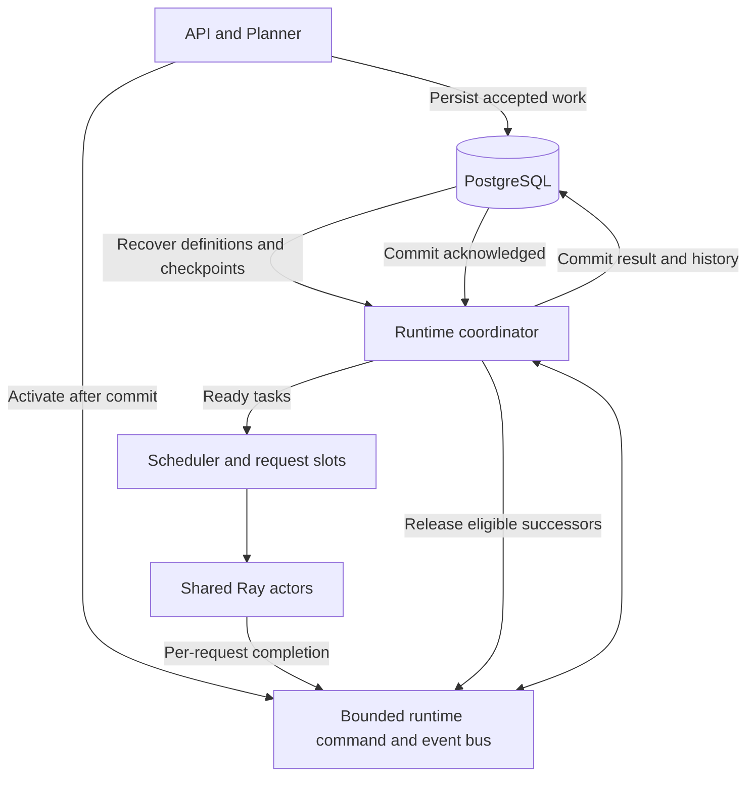

# Runtime and storage refactor plan

Status: design record. The implemented boundaries and concrete schema are documented in
[Runtime, storage, and multi-turn execution](RUNTIME.md). The table inventory below is the
original proposal, not the exact implemented names. This design permits breaking schema and API changes;
it requires no compatibility adapters, dual writes, or automatic conversion of old records.
It does not authorize dropping the existing database.

## Evidence and objective

The supplied local `\dt` output contains `benchmark_protocol_definitions` and
`benchmark_protocol_instances`. Current SQLAlchemy models and `sql/postgresql/init.sql`
instead define `benchmark_task_definitions` and `benchmark_task_instances`. Connectivity
health is therefore insufficient to establish that the running service, source, and schema
agree. Existing `CREATE TABLE IF NOT EXISTS` statements do not migrate older tables.

Current persistence performs orchestration: `materialize_due_work` selects due Dispatches,
`claim_next` chooses queued Runners, and `_advance_task_instance` evaluates dependencies
and releases successors. Completion currently arrives at Runner granularity. Moving only
table names or adding a queue around these methods would retain the same boundary problem.

The target is PostgreSQL as durable truth, with a reconstructible runtime responsible for
live execution decisions. Runtime queues are transient; accepted work and committed results
must survive their loss. A Runner remains a logical workload and reporting boundary.

## Ownership

| Component | Responsibility |
|---|---|
| Compiler / Planner | Validate and compile finite workloads; admit immediate or scheduled executions |
| Runtime coordinator | Own active DAGs, dependency readiness, barriers, delays, and history versions |
| Scheduler | Fairly allocate request slots, enforce pacing and limits, supervise cancellation |
| Shared Ray actor pool | Execute requests with isolated per-request state and bounded concurrency |
| Repository | Commit metadata, fenced attempts, checkpoints, history, results, and audit events |
| PostgreSQL | Enforce durable identities, ownership, uniqueness, and transactional consistency |

Start with bounded in-process typed queues and Ray result delivery. Do not add an external
broker for the single-Backend deployment. PostgreSQL transactions remain necessary at
durability boundaries; it no longer serves as a per-request ready queue. Periodic durable
reconciliation repairs missed activation signals and control intents without scanning all
task dependencies on every scheduling tick.

## Proposed durable schema

Names below describe the replacement contract, not tables already available to query.

| Table | Contents and boundary |
|---|---|
| `campaigns` | Workload ownership, labels, durable cancellation intent, lifecycle and outcome |
| `schedules` | Bounded recurrence, template reference, occurrence cursor and pause intent |
| `task_definitions` | Immutable validated workload, compiled DAG, configuration version and digest |
| `task_instances` | Definition reference, parameters/seed, instance identity and lifecycle |
| `runners` | Logical workload configuration, instance/occurrence linkage and aggregate outcome |
| `execution_checkpoints` | Per-instance revision, committed node progress, durable delay anchors and history references |
| `execution_leases` | Instance owner, fencing generation and lease expiry for recovery |
| `task_attempts` | Atomic request identity, node/request index, attempt number, owner generation, state and timing |
| `request_results` | One terminal result per attempt, usage coverage, metrics, errors and payload references |
| `conversations` | Instance-scoped conversation identity and latest committed history version |
| `conversation_messages` | Immutable role/content records, turn/order, parent history version and producing attempt |
| `execution_events` | Durable lifecycle audit records linked to Campaign, Runner, instance and attempt as applicable |
| Existing identity tables | Retain `users`, `trusted_client_keys`, and `trusted_client_events` responsibilities |

Remove the Dispatch table as a live queue. Replace Runner/RunnerPlan event tables with
typed execution audit events. These events are neither token-stream logs nor a required
event-sourcing engine: checkpoints and normalized results are sufficient for recovery.
Keep schedule occurrences unique by `(schedule_id, occurrence)` independently of task
attempt identities.

Use foreign keys and explicit columns for ownership, version, state and lineage instead
of hiding those fields inside JSON. Keep workload specifications and extensible metrics
in JSONB. Enforce unique `(instance_id, node_id, request_index, attempt_number)`, one result
per attempt, and unique conversation history positions. Index unfinished instances, lease
expiry, schedule due times, and result lookup; no index is needed for an in-memory ready
queue. Remove obsolete subprocess fields from Runner records.

For the first implementation, store conversation content durably in PostgreSQL and pass
message IDs/history versions through the runtime bus. Do not copy full accumulated history
into each queue message or checkpoint. Larger artifact storage can follow behind the same
reference boundary; a Ray ObjectRef alone is not a durable payload reference.

## State, delivery, and recovery

- Durable instance lifecycle: `accepted`, `active`, `completed`, `cancelled`, `interrupted`.
  Keep aggregate outcome separate from lifecycle, including failed or indeterminate work.
- Runtime node state: `blocked`, `delayed`, `ready`, `executing`, `awaiting_commit`, then
  terminal. Reconstruct readiness and timers from the DAG and committed progress.
- Durable attempt state: `prepared`, `executing`, `succeeded`, `failed`, `cancelled`,
  `indeterminate`. Record execution intent before sending the request. A crash across the
  send boundary can leave an uncertain external outcome; never silently replay it.
- Commands/events carry a message ID, instance/Runner/node/attempt identities, owner
  generation, schema version and payload reference. Persist state transitions idempotently;
  reject stale-generation completions and duplicate history appends.

The Scheduler may free physical request capacity when execution ends. The coordinator
must commit the result, new assistant message, history version, checkpoint and audit event
in one transaction before releasing dependent turns. A slow database therefore delays
successor eligibility, even if a physical request slot is already free. Bound uncommitted
completion buffers and stop new admissions when persistence falls behind.

On restart, acquire a new fenced lease, recover accepted instances, load their graphs and
checkpoints, and reconstruct readiness and timers. An old owner stops dispatching when it
cannot renew its lease; generation checks reject its later database writes. Fencing cannot
undo an HTTP request already sent. Unresolved executing attempts become indeterminate
under the default no-retry policy, and dependent turns do not advance. Committed attempts
are never executed again. Durable cancellation intent takes precedence over new dispatch;
late results remain auditable but cannot reactivate cancelled work.

Use monotonic time for live duration measurements and UTC timestamps for restartable delay
anchors. Recovery does not promise identical benchmark timing: record interruptions in
results so recovered executions cannot be mistaken for uninterrupted measurements.

## Request capacity and multi-turn execution

Keep eight actors initially. Configured request capacity is `actor_count × requests_per_actor`;
eight actors with eight requests each yield 64 slots. CPU resources govern actor placement,
not the meaning of a request slot. Per-Runner, global and Provider limits further bound
actual concurrency. Publish configured, ready, executing and available capacity separately.

A waiting turn or barrier consumes no request slot. Ready requests from different Runners
may share an actor, retaining separate credentials, histories, cancellation and metrics.
Actor execution must avoid mutable shared per-Runner settings. Grouping is an optional
dispatch optimization: each request completes independently, and no whole-group completion
barrier may delay a successor that is otherwise eligible.

For multi-turn workloads, each conversation has one outstanding turn unless the graph
explicitly defines a fork. Input history identifies an immutable committed version. An
optional round barrier is a DAG dependency, not an actor or database lock. Load pacing and
benchmark timing remain explicit workload semantics, separate from storage latency.

## Delivery and acceptance

1. Define typed runtime envelopes, atomic task/result models, and replacement schema.
2. Implement repository transactions and schema-version readiness checks. An incompatible
   schema must prevent scheduling and report `schema_mismatch`, even when `SELECT 1` works.
3. Implement coordinator recovery, idempotent completion, timers and durable control intent.
4. Add the shared actor pool and per-request completion path; define slots as request capacity.
5. Add conversation history and turn dependencies through compiler, runtime and persistence.
6. Update API/CLI status and exports, workload examples, analysis, and architecture docs.
7. Validate a fresh disposable PostgreSQL database with crash, duplicate event, stale owner,
   cancellation, failed commit, delayed barrier and multi-turn tests; run static checks and
   normal repository gates, plus real Ray concurrency tests.

Cut over using a fresh database after source and schema pass those checks. Stop the service
before switching its database configuration, verify readiness after restart, and retain the
old database until its disposition is explicitly decided. No old-schema conversion or
compatibility budget is required. The running database and application code are unchanged
by this plan.
