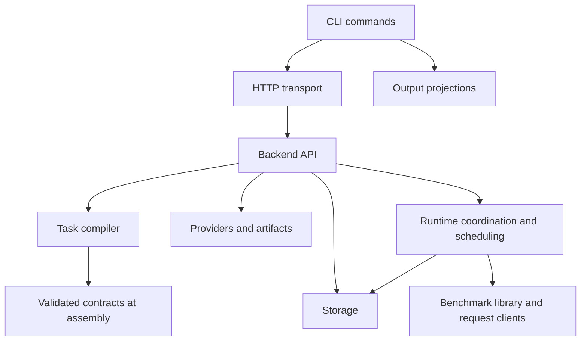

# LLMPerf Architecture

See [Runtime, storage, and multi-turn execution](runtime.md) for the implemented
database layout, shared request capacity, message history, and recovery behavior.

## Source layout and references

Python packages and modules use `snake_case`. Documentation uses lowercase hyphenated
filenames, with `README.md` reserved for directory entry points. Workloads use
`example-<purpose>.yaml`. A package groups one functional area; imports name the owning
module explicitly, and package initializers do not eagerly import the application.

```text
src/
├── llmperf/                       # Provider-independent benchmark library
│   ├── benchmark/                 # Throughput, correctness, and budget sampling
│   ├── clients/                   # Request models, adapters, and client construction
│   ├── configuration/             # User environment and logging
│   ├── datasets/                  # Prompt construction, preparation, tokenizer, corpus
│   ├── metrics/                   # Usage normalization, cache analysis, result exports
│   └── version.py                 # Shared protocol and release identifiers
├── llmperf_backend/
│   ├── api/                       # FastAPI composition and authentication
│   ├── artifacts/                 # Artifact resolution and outbound network policy
│   ├── compiler/                  # Task graphs, round expansion, admission estimates
│   ├── configuration/             # Validated contracts, config loading, YAML defaults
│   ├── providers/                 # Profile files, registry, and model discovery
│   ├── runtime/                   # Coordinator, Planner, Scheduler, Workers, request pool
│   └── storage/                   # SQLAlchemy records and durable transactions
├── llmperf_cli/
│   ├── commands/                  # Argument parsing and command execution
│   ├── configuration/             # CLI environment selection
│   ├── presentation/              # Validated output projections
│   └── transport/                 # HTTP client and request signing
└── llmperf_tools/
    └── huggingface/               # Cache-link transfer utilities
```

The CLI talks to the Backend through HTTP and imports shared version/configuration
helpers, not Backend execution internals. The benchmark library does not import the Backend
or CLI. Backend API composition connects its functional packages; compiler expansion does
not depend on Scheduler or database execution. The assembler imports resolved benchmark
contracts only at the serialization boundary. The following dependency view shows the main
relationships rather than every utility import:



Keep new imports pointed at their owner, such as `llmperf_backend.compiler.tasks` or
`llmperf.datasets.prompts`. Internal Python import paths changed during this organization;
they are not HTTP/API compatibility aliases. The `llmperfctl`, `llmperf-backend`, and
`llmperf-cache-links` commands remain stable. Thin entry points retain `python -m llmperf_cli`
and the former standalone benchmark module commands. No command shim is used internally.

Packaged defaults live under `llmperf_backend.configuration/configs`; the bundled corpus
lives under `llmperf.datasets`. Package data declarations must move with these resources.
Build and inspect the wheel when changing their locations. Existing remote installations
keep their installed code until a separate deployment updates them.

## 1. Design boundary

LLMPerf separates workload authoring, compilation, scheduling, execution, and analysis.
A Runner owns a complete task; its atomic execution primitive is a one-request Worker. Experiment vocabulary such as
Prime, Warm, Probe, retention, and promotion is metadata, never Planner behavior.

`compiler/requests.py` owns request execution logic, repetition, and `depends_on`
primitives. `compiler/tasks.py` composes outer Runner workflows. `runtime/runner.py` listens
to committed completion and timer messages, checks dependency success, cancels affected
descendants, and assembles any reused messages before submission. `runtime/messages.py`
owns the message data structures and delivery, not execution decisions. Scheduler admits
ready Workers to slots; each Worker sends one request and returns.

```text
YAML authoring syntax
  instances(matrix, trials, seed) / workflow / invoke / run / repeat / parallel / sequence
                    │
                    ▼
             Workload Compiler
                    │
      finite CompilationTable (atomic and batch DAG)
                    │
                    ▼
  PostgreSQL metadata -> Runtime coordinator -> Scheduler -> Shared Ray actors -> Provider
                    │
                    ▼
    export 1.0.0 -> normalized evidence -> autonomous HTML rendering
```

Version 1.0.0 defines the first supported task-graph, persistence, export, and analysis
contract. Pre-release protocol registries and experiment-specific state machines are not
part of the release surface.

### 1.1 Versioned format inventory

| Surface | Version marker | 1.0.0 contract |
|---|---|---|
| Python distribution and CLI | package `version` | `1.0.0` |
| Backend configuration YAML | root `version` | string `"1.0.0"` |
| Runner and Campaign YAML/JSON | root `version` | string `"1.0.0"` |
| HTTP control plane | route prefix | `/api/v1` |
| RunnerPlan persisted template | `template_version` / `plan_template_version` | string `"1.0.0"` |
| Compiled task definition and instance | `format_version` | string `"1.0.0"` |
| Runner and Campaign export | root `version` | string `"1.0.0"` |
| Benchmark result envelope | root `version` | string `"1.0.0"` |
| Normalized report evidence | `analysis_version` | string `"1.0.0"` |
| Render plan and review | `render_plan_version` / `render_review_version` | string `"1.0.0"` |
| Hugging Face cache-link manifest | `schema` suffix | `llmperf-huggingface-cache-links/1.0.0` |

`llmperf.version` is the runtime authority for release, protocol, and compiled-task format
identifiers. External YAML is strict: the version is mandatory, unknown fields are rejected,
and unsupported format versions require explicit migration. The task input boundary retains
normalization of the former sequence/kind syntax within the current version. The `/api/v1` path is the HTTP major-version boundary; request models reject an
explicit non-1.0.0 body version.

## 2. Control plane

FastAPI validates operator input and resolves Backend-owned Provider Profiles. Provider
URLs and credentials never enter task YAML. Campaign creation is atomic: invalid input or
an admission failure creates no partial workload.

Workload YAML selects only a stable Provider ID and model ID. The matching Backend Profile
owns `adapter` (`openai`, `anthropic`, `litellm`, `sagemaker`, or `vertexai`) and injects it
into the frozen Runner after validation; URLs, model names, and discovery modes never imply
an adapter. All adapters can execute ordinary or compiled Runners. Cache-analysis claims
remain conditional on the selected Provider returning comparable usage counters.

Provider definitions live in one versioned YAML or JSON document with a `providers` map.
`LLMPERF_PROVIDERS_FILE` selects its path; otherwise the Backend discovers one
`providers.yaml`, `providers.yml`, or `providers.json` beside its environment file. Explicit
relative paths resolve against that directory. A selected file is authoritative for all
profiles. Environment-defined profiles are no longer supported; a missing Provider file
is a configuration error. Environment values supply only explicitly referenced credentials. Missing explicit files, ambiguous discovery, duplicate keys/normalized IDs,
unknown fields fail validation without a partial reload. Provider startup errors are isolated:
the API starts with an empty registry and a public configuration error, recoverable by reload.
`api_key` stores an inline secret; alternatively `api_key_env` references a source variable.
Empty or missing keys are allowed. Both sources cannot be specified together.
Optional `worker_api_key_env` and
`worker_api_base_env` specify adapter destinations. Source and destination credential
variables for all profiles, including removed profiles, are stripped before injecting the
selected profile into a Worker. Secret values are not part of public profile documents.
`provider reload` rereads the complete document and credentials and swaps one validated
registry generation; existing Runner connection snapshots remain unchanged.

The performance guard estimates the fully expanded graph before acceptance:

- compiled Runner count;
- Provider request count;
- input/output token budget;
- per-Runner and effective concurrency;
- available Ray Actor capacity.

Unknown benchmark defaults remain visible as admission warnings. A `repeat` is finite and
bounded; there is no runtime loop capable of escaping static accounting.

### 2.1 Backend ownership layers

Backend support code is organized by stable ownership boundary rather than by individual
download or validation features:

- `providers/files.py` owns strict Provider YAML/JSON decoding and credential-reference resolution;
- `configuration/loader.py` owns dotenv discovery, Provider source selection and reloads, YAML expansion,
  validation, and the atomic active configuration store;
- `artifacts/outbound.py` owns process-wide HTTP(S) proxy normalization, the Hugging Face HTTP
  client, native Xet proxy visibility, and the explicit direct-connection policy for Ray
  control traffic;
- `artifacts/resolver.py` owns the common artifact descriptor and resolver capabilities, Hugging
  Face identity rules, dataset and tokenizer materialization, and active post-download
  integrity validation.

Dataset and tokenizer caches receive the same immutable outbound policy. Their resolutions
implement one artifact descriptor protocol, so preflight validation depends on the common
contract rather than importing and type-dispatching over concrete cache implementations.
Artifact validation also exposes an NDJSON stream of path-free byte progress, heartbeat,
and terminal result events. This keeps Hugging Face filesystem paths inside the Backend
while allowing a remote CLI to render transfer progress on stderr.
Worker runtime constants remain in `runtime/worker.py`; importing a Worker does not initialize the
Backend artifact stack merely to obtain its dataset handoff key. Worker-side token counting
retains its separate execution dependency on Transformers.

Prompt construction and cache-probe mutation use the tokenizer before timed execution.
The default `benchmark.output_token_count=provider` never tokenizes responses. Request
actors do not load tokenizers; SageMaker and Vertex prediction schemas without usage return
unknown output counts. After request threads join and the finish timestamp is captured,
the Runner reconciles metrics using server usage. Input counts fall back to the prepared
local estimate with explicit provenance. Missing output usage stays null, including derived
token throughput and TPOT, and cannot be replaced by SSE-event counts or output budgets.
Summary output-token coverage counts successful requests with known counts; any missing
count makes overall output throughput null. Distribution statistics use known counts only.
Optional `output_token_count=local` retains generated text until this finalization phase
and counts output tokens once in the Runner, outside its measured duration. Provider
counts remain separate. Both ordinary Runners and cache probes follow this boundary.

This separation is informed by SGLang's
[benchmark metrics finalization](https://github.com/sgl-project/sglang/blob/main/python/sglang/benchmark/serving.py),
which calculates benchmark duration before retokenizing outputs. LLMPerf's default skips
that retokenization entirely; local counting is explicitly requested.

## 3. Workload compiler

The compiler expands matrix coordinates and trials into finite graphs of atomic `invoke`
and batch `run` nodes. `repeat`, `parallel`, and `sequence` define dependencies and delays.
It derives deterministic seeds and assigns runtime identities only after logical compilation.
The runtime coordinator owns readiness; Scheduler owns execution.

[Task compiler and YAML rules](tasks.md) contains the supported definition contract,
instance/workflow/Runner mapping, primitive semantics, seed rules, limits, and implementation
boundaries. [Dataset configuration](usage.md#workload-examples-and-task-definitions) describes
artifact adapters and prompt construction. [Runtime](runtime.md) owns capacity and storage.

## 4. Persistence and runtime ownership

[Runtime storage](runtime.md#durable-records) documents the concrete schema and ownership.
PostgreSQL stores metadata, checkpoints, attempts, immutable messages, results, and audit
records. `execution_nodes` replaces the Dispatch queue as durable node progress. Readiness checks required tables and columns before scheduling; there is no schema-version marker.

## 5. Planner and Scheduler

Planner materializes bounded schedule occurrences. RuntimeCoordinator computes dependencies
and due times, reconciles durable state, and admits eligible Runners through a fair in-memory
queue. A lossy reconciliation notifier wakes it after durable changes. Runner output and timer
messages use a separate durable mailbox. Waiting dependencies and delays
reserve no physical request capacity. The single Backend owner holds a fenced durable lease.

## 6. Worker and observability

### Request and actor concurrency

Eight shared Ray actors with eight requests per actor provide 64 request slots by default.
`live_slots` and `busy_slots` report physical request capacity and execution; active Runner
handles have an independent bound. Runner-owned preparation uses cached tokenizers and a
local executor; its async listener submits atomic Workers through Scheduler backpressure.
Every request uses the shared pool with isolated adapter state and credentials. An explicit
`concurrent_requests` applies an optional ceiling; by default Scheduler owns admission.

Each compiled invoke completes independently. The runtime combines ready work across
Runners at the actor pool without a static group barrier. Multi-turn invokes use an
instance-scoped conversation name and dependency-ordered immutable history versions.
Successors become eligible only after result, messages, and checkpoint commit atomically.
See [configuration and examples](runtime.md#capacity).

### Request evidence

Runner preparation builds prompts and metadata. Each Worker sends its prepared request
through the selected Provider adapter; the Backend persists:

- request start and completion timestamps;
- input/output token counts and TTFT/E2E metrics;
- Provider cache hit/miss counters when available;
- `prompt_hash` and local tokenizer count;
- summary, error, timeout, stdout, and stderr evidence.

Provider counters are accounting evidence. TTFT deltas and speedup are performance
evidence. Reports must keep these concepts separate and expose counter coverage and sample
size.

### 6.1 Extension horizon for complex observers

Future observer support should preserve the current separation between compilation,
dependency planning, execution, and reporting instead of adding experiment-specific
branches to the Planner. The intended extension seams are:

- a versioned, provider-neutral observer evidence envelope containing the observer kind,
  measurement interval, subject references, quality flags, and immutable artifact hashes;
- a typed execution capability for observers that cannot be represented as a normal
  request-backed Runner, while retaining one bounded unit of work per dispatch;
- generic dependency completion policies for optional, quorum, or continue-on-error joins;
- bounded compilation epochs for adaptive experiments, where a controller appends a
  versioned graph fragment transactionally rather than running an implicit loop inside a
  Worker or the Planner; and
- immutable artifact references for carrying observations between epochs without
  coupling orchestration state to provider-specific payloads.

Any such extension must expose a worst-case node, request, token, duration, and resource
budget to admission control. It must also retain deterministic identifiers and durable
evidence so that restart, replay, and audit properties remain intact.

## 7. Export and reporting

Campaign export 1.0.0 contains:

- `campaign` and `aggregate`;
- `runner_plans`;
- `task_definitions` and `task_instances`;
- `dispatches` with full lineage;
- generic joined `task_analyses`;
- `runners`, optionally with request records.

The report preparation script performs schema validation, cohort normalization, task graph
joins, and metric extraction. It does not prescribe chart types or infer experiment meaning
from fixed Provider/protocol names. The rendering Agent chooses the smallest useful visual
for actual data, keeps important conclusions large, folds Runner details, and may combine
bars and lines only when their units and relationship are clear.

Stable visual rules remain centralized:

- assign Provider series by deterministic slot order using a high-contrast palette; never
  match literal Provider names;
- keep hit-rate axes within 0–100%;
- show a 1× reference for speedup;
- use “Warm acceleration” or “Warm TTFT improvement”, not “Warm is faster” as an
  unsupported absolute claim;
- align table titles and use restrained curve smoothing that cannot invent extrema;
- preserve multiple Provider series in comparisons.

## 8. Failure and restart behavior

- A CLI disconnect does not affect Campaign execution.
- A Backend restart leaves pending/blocked Dispatches and queued Runners durable.
- An interrupted executing Runner becomes indeterminate; automatic replay is disabled.
- An atomic task node without `prompt_hash`, or a replay whose hash changed, fails its instance.
- Missing cache counters remain missing; they are never converted to zero or a miss.
- This schema has no migration bridge from the removed protocol tables.

## Module ownership audit

Keep related helpers with their owning layer. Named-input preparation and calculation live
in `runtime/preparation.py`; time conditions and timer event generation share
`runtime/triggers.py`. The private sampling helper lives in benchmark throughput, and task
evidence projection lives in metrics results. These helpers do not require separate files.

The small shared request models, execution protocol, duration type, and SQLAlchemy base
remain separate: they serve several modules and prevent implementation-layer imports or
metadata cycles. `compiler/requests.py` is a reusable grammar/compilation boundary used by
configuration, admission, and runtime, rather than a private preparation helper.
