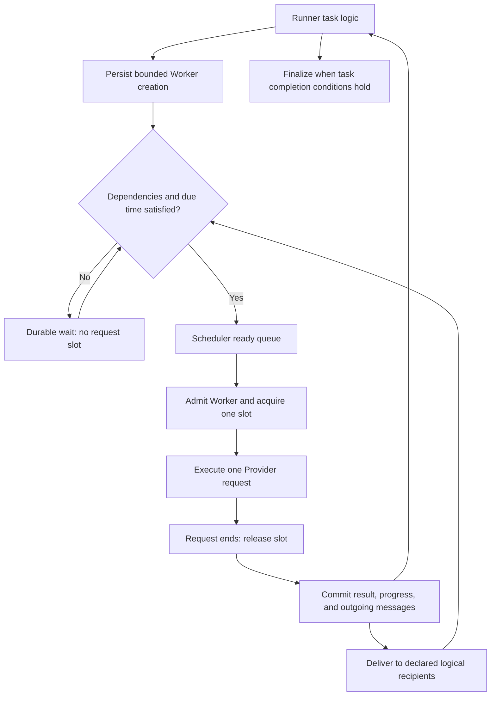

# Runner tasks, atomic Workers, and messaging

Status: implementation plan and tracked boundaries, October 16, 2026. The atomic Worker
dispatcher, async Runner listener, optional window, generic durable messages, inherited chat
records, and common trigger evaluators are implemented. Runner owns named inputs and inference settings; `runner.request` defines
execution logic and message composition; `depends_on` optionally reuses one or multiple committed message sources.
Runner owns dependency failure checks and cancellation propagation. Current contracts are documented in
[Tasks](../tasks.md) and [Runtime](../runtime.md).

Remaining extensions are transactional Runner checkpoint/restart, streaming request-plan
admission, externally imported task plugins, arbitrary cross-Runner message bindings, and latency
threshold predicates. Calendar RunnerPlans still materialize outer Runners through Planner;
the new Runner timer source supports absolute dates and bounded fixed intervals. Requirements
below for those extensions are design targets, not claims of implemented behavior.

## Agreed model

**Runner is one complete task. Worker is one atomic step that advances that task.**
A request slot is temporary capacity assigned while a Worker executes its request.
Runner and Worker identities do not identify a thread, Ray actor, or GPU.

| Concept | Responsibility |
|---|---|
| Runner | Own progression, dependency success checks, descendant cancellation, timing, submission, and aggregate outcome |
| Task logic | Interpret Worker templates, timing conditions, request inputs, and completion rules for the Runner |
| Worker | Execute one bounded step; for the initial implementation, one Provider request with no automatic retry |
| Scheduler | Admit submitted eligible Workers fairly within shared request capacity |
| Slot | Account for one in-flight Provider request until physical completion |
| Message pipeline | Reliably transfer committed outputs to declared logical recipients |
| Reconciliation notifier | Wake the runtime to reread durable state; notifications may be lost |
| Repository | Persist and fence state transitions, results, messages, and progress |

Runner maintains Worker submission to Scheduler according to resolved upstream configuration:
task logic, trigger conditions, dependencies, request inputs, and any explicit submission limit. The
compiler validates and resolves that configuration; Scheduler does not reinterpret it.
The runtime executes task logic on behalf of a Runner. Workers receive a frozen step
input and return results; they do not own the entire task state machine. Imported logic
must use this boundary. Implement the existing declarative configuration adapters first;
arbitrary executable plugin loading is a separate extension, not a prerequisite for the
runtime refactor. Do not introduce an unvalidated Python import field in workload YAML.

Existing task definitions and TaskInstances describe an outer workflow that can create
multiple Runners. Calling a Runner a complete task does not make it identical to the
existing `TaskDefinition` type. Outer workflows arrange Runners; internal task logic
arranges Workers. A Runner template remains configuration used to create Runners.

```text
Campaign
└── Runner: one complete task
    ├── task logic, durable state, and shared budgets
    ├── Worker: one request step
    ├── Worker: another request step
    └── future steps created from results, messages, or due times
```

## One execution path for pressure tests and multi-turn tasks

A pressure-test Runner creates independent Workers and submits ready steps in parallel.
Runner controls which work is eligible; Scheduler controls backpressure, fair admission,
and physical execution capacity. **There is no Runner submission window by default.**
The finite `request.repeat` and `request.steps` expansion determines the planned Workers. Scheduler admission can interleave
requests from other Runners; submitting eight Workers does not reserve eight slots.

An explicit `runner.concurrent_requests` may be used when an experiment requires a per-Runner
ceiling. In that case it is a rolling limit over submitted, unfinished Workers across all
branches. A committed completion allows a replacement without waiting for the group.
Queued, executing, and result-awaiting-commit Workers count toward this optional limit.
There is no second per-Runner in-flight ceiling. Future ineligible steps occupy neither
Scheduler capacity nor this optional window.

Scheduler backpressure must suspend submission without blocking the Runner's event
listener. Keep at most one blocked submission operation per Runner; do not create an
unbounded coroutine for every ready request. The public `concurrent_requests` setting maps to this optional limit. Omission leaves
admission to Scheduler; an explicit value preserves the experiment concurrency ceiling.

## Asynchronous Runner progression

The Runner runtime asynchronously listens for committed Worker completions, incoming
messages, timer expirations, and cancellation. Its listener is a lightweight control-plane
operation, not a Worker, request slot, or reserved Ray actor. It awaits events instead of
polling each Worker or synchronously waiting for a whole group.

On an event, serialize progression for that Runner, reload the authoritative checkpoint,
apply the event idempotently, and apply any explicit submission ceiling. Task logic generates
eligible steps for bounded Scheduler admission. Persist creation decisions, message consumption, and
submission reservations transactionally; then notify Scheduler that durable work is ready.
Do not hold the progression lock or database transaction during Provider execution.

```text
Worker result commits → async Runner listener wakes → update task checkpoint
    → submit eligible Workers under Scheduler backpressure → await next event
```

When an explicit window is configured, completion opens a position after its result commits. Physical HTTP completion
releases the shared request slot earlier if persistence is still pending. A dependency or
future due time may leave the window partially empty; the limit does not force premature
submission. A request failure also reaches a committed terminal outcome, but task failure
policy determines whether replacement work is permitted.

Use durable completion/message records with a replay cursor or equivalent persisted
consumption state. In-memory wakeups can shorten latency, but cannot be the only record
of an event. Register the listener and drain pending records without a subscribe/read race;
startup and periodic reconciliation repair missed wakeups. Duplicate delivery cannot
release a window position twice or create duplicate replacement Workers. Cancellation
must wake an idle listener and prevent further creation. An idle listener holds no slot.

A multi-turn Runner creates a Worker for the first turn. After that result and history
commit, its task logic creates the next turn, optionally with a future eligibility time.
The next Worker receives the committed history and its new input. Independent conversation
branches can run concurrently, but dependent turns in one history remain ordered.

Conversation, scenario, and pressure testing are task logic patterns. They do not require
separate scheduling architectures or Workers that hide loops of Provider requests.
Shared dataset preparation and calibration remain reusable Runner resources; moving to
one Worker per request must not repeat expensive setup for every request.

## Unified triggers and upstream configuration

A trigger determines eligibility; Runner determines which Workers to submit; Scheduler
determines admission and actual start. Upstream configuration supplies all task conditions. An event
wakes the Runner to reevaluate them; receiving an event alone is not permission to send.

| Input | Normalized condition | Current feature to preserve |
|---|---|---|
| Absolute date/time | UTC due instant | RunnerPlan `starts_at` and `ends_at` |
| Calendar recurrence | Due occurrence with stable occurrence ID | Daily/weekly schedules, IANA timezone, DST rules |
| Fixed interval | Due instant calculated from schedule origin | RunnerPlan `every` |
| Relative delay | Durable anchor timestamp plus duration | Task `after` and completion-relative repeat delays |
| Worker completion | Required outcome committed | Rolling refill and ordered task dependencies |
| Message | Required input committed and available | Proposed Worker output exchange |
| Measured latency | Predicate over committed request metrics | Proposed extension; no existing threshold-trigger implementation found |

Keep fixed schedule intervals and completion-relative delays distinct. For a relative
delay, name its anchor explicitly; existing task dependencies use predecessor completion
timestamps, or instance creation for roots. Persist the computed UTC due instant so a
restart does not restart the delay. For a latency predicate, define the metric and units,
comparison, aggregation scope, and missing-value behavior; unknown latency does not match.
Evaluate a metric occurrence once. Repeated threshold reactions require explicit rearming
or cooldown, not a loop that continuously fires on the same stored value.

A shared trigger evaluator and timer facility serves both outer schedules and internal
Runner progression. Planner remains responsible for materializing RunnerPlan occurrences;
Runner runtime remains responsible for Worker submission. This unifies timing mechanics
without making Scheduler interpret calendar rules or turning each timer into a Worker.
Timer sources publish durable `timer.due` messages to the same Runner-layer message bus
used by Worker outputs. Date and periodic/delay events never submit Workers directly.
Future work occupies neither a request slot nor the submitted-Worker window.

Preserve interval/calendar bounds, `queue`/`skip` overlap policy, misfire grace, occurrence
identity, cancellation, and DST decisions (skip nonexistent local times, choose the first
ambiguous instant). Persist skipped occurrences. A due instant is earliest eligibility,
not a guarantee of exact execution time. Track due time, submission time, and request start
separately. When Scheduler cannot accept work, retain it under bounded backpressure while continuing
to listen for events. Respect an explicitly configured Runner limit for every trigger type.

Use timezone-aware UTC for durable timestamps and monotonic time for local elapsed waits.
Recheck durable eligibility on wakeup and reconcile after clock adjustments or restart.
All required dependencies, inputs, timing conditions, and active-state checks must pass
before submission. Cancellation invalidates outstanding timers/subscriptions as well as
closing Worker creation.

Sources: [schedule contracts](../scheduling.md),
[recurrence calculation](../../src/llmperf_backend/runtime/planner.py), and
[dependency timing](../../src/llmperf_backend/runtime/coordinator.py).

## Inheritance and implementation boundaries

Use shallow inheritance for interchangeable behavior, with composition for services:

```text
RunnerRuntime                         # shared async listener and submission lifecycle
├── TaskLogic (abstract interface)     # state + upstream configuration → eligible steps
│   └── WorkflowTaskLogic             # interprets steps for pressure, multi-turn, etc.
├── Trigger (abstract interface)       # facts + time → eligibility and next wakeup
│   ├── DateTrigger
│   ├── DelayTrigger
│   └── DependencyTrigger
├── Repository protocol               # fenced persistence and atomic transitions
└── Scheduler protocol                # atomic Worker submission and cancellation
```

The tree shows composed dependencies; RunnerRuntime does not inherit from TaskLogic,
Trigger, Repository, or Scheduler. Concrete task logic inherits only its behavioral
interface. Pressure and multi-turn are configurations of the same workflow implementation;
pressure tasks may include dependencies, warm-up, and delays. Add a subclass only when a
different execution behavior requires it, not because a benchmark has another name.
A Worker executor interface can similarly have transport-specific implementations,
all preserving one request per Worker. Do not subclass a batch executor merely to inherit
fields that do not apply to an atomic executor.

Keep listener registration, deduplication, window accounting, cancellation, and result
commit handling in the common runtime. Behavior hooks return typed decisions rather than
performing hidden Provider calls, mutating the Scheduler, or opening SQL sessions. Triggers
evaluate facts without sending requests. Prefer protocols at service boundaries and ABCs
where shared implementation or explicit abstract hooks are useful. Avoid multiple-inheritance
combinations such as scheduled/conversation/pressure Runner subclasses. Calendar recurrence
is composed with a task pattern, not a new Runner type for every combination.

## Worker lifecycle and slots

The Runner retains continuations, history, timer conditions, and message subscriptions.
Waiting for another time window or message consumes no request slot. A completed Worker
does not resume to send another turn: that turn is a new atomic Worker under the same
Runner. Worker records may wait for eligibility, but no live executor is needed to wait.



At most one request is in flight per Worker. Physical request completion governs slot
release, including cancellation; cancelling a caller must not free capacity while its
HTTP operation still runs. Durable result commit governs successor readiness. These are
different boundaries. Limit completed results awaiting commit and stop further admission
when persistence cannot keep up.

Atomic means one execution/result boundary, not an exactly-once distributed transaction
with the Provider. Preserve ambiguous execution as indeterminate and do not automatically
resend. Worker results require attempt identity and owner-generation fencing.

## Implemented bus mechanisms

`RuntimeCoordinator` owns the lossy `ReconcileNotifier`, shared across Runners. Its queue
coalesces hints and falls back to periodic reconciliation. `release_runner(runner_id)`
releases outer admission and requests a state refresh; its name does not imply success.

Each admitted Runner receives a `RunnerMessageBus` backed by PostgreSQL. Worker completion
and timer messages have stable IDs; receipts are scoped to the consumer. In-process
conditions provide wakeups while periodic reads recover missed notifications. Generic
`MessageRecord` owns routing and payload; `ConversationMessageRecord` inherits it through
a joined table. The bus addresses logical destinations, never physical request slots.

Worker reservation and result publication are fenced transactions. Publication includes
the output message in the same transaction; Runner consumption and dynamic progression
are not yet a transactional restart checkpoint. Interrupted Runners fail indeterminate
without automatic replay. Cross-Runner delivery is not exposed as workload syntax.

## Reliable messaging boundary

Messaging is a general Runner-layer facility. Generic message records own identity,
Runner scope, source/destination, topic, payload, and creation time. Chat records inherit
from that common record and add conversation ordering and role/content fields. Worker
outputs, date/periodic/delay events, and task messages use the same durable bus.

Move request loops, dependency evaluation, message handling, history assembly, and waiting
out of Workers into Runner progression and its event sources. Workers perform only a
prepared request and report its result. Scheduler owns bounded admission and physical
capacity. Runtime queues and notifications remain reconstructible.

Keep the existing mechanism as a reconciliation notifier. Separate admission release
from notification publication and use names that do not imply a commit acknowledgement.
A reliable message pipeline is a new responsibility, not an additional payload field on
the existing lossy queue.

- Commit Worker results, task progress, and outgoing messages in one database transaction.
  If an external broker is introduced later, publish through a transactional outbox.
- Address messages to stable logical destinations, such as a Runner mailbox or named
  step input. Do not address a physical slot or require a receiving executor to be alive.
- Give each message a stable ID and record consumption with the receiving state change.
  Delivery may repeat; deduplicate its effects. This does not make Provider calls exactly once.
- Activate a receiving Worker only after all declared inputs and timing conditions hold.
  Workers can exchange outputs within a Runner; cross-Runner communication needs explicit
  bindings, ownership, cancellation, and completion rules before enabling it.
- Preserve declared ordering where required, especially a single conversation history.
  Do not assume global ordering across independent Workers.

Commit acknowledgement comes from the repository transaction. Cancellation is durable
intent enforced by Scheduler. Neither depends on receiving a disposable notification.
The initial pipeline can use PostgreSQL mailboxes without introducing a separate broker.

## Dynamic creation, limits, and completion

Runner task logic may create Workers dynamically. Runtime admission enforces the following
limits rather than trusting imported logic to respect them:

- A finite declared Worker expansion, with atomic reservations before Workers can send.
- No Runner concurrency limit by default. An explicit outstanding-Worker limit, if set,
  rolls forward after committed completions; no duplicate in-flight ceiling.
- Global physical capacity, fair admission, and Backend-owned queue/message backpressure.
- A task deadline and bounded input/history/message sizes; token budgets where configured.

Task request count or another explicit termination condition describes how much work to
perform; it is distinct from submission width. Internal resource bounds need not become
additional workload knobs. For one-request Workers, derive the total Worker bound from
the declared expansion instead of requiring a second submission-budget setting.

Make Worker creation idempotent using the originating decision and child index. Concurrent
results must not duplicate steps or overshoot a shared budget. Apply explicit backpressure
when pending capacity is full; do not silently discard accepted steps or messages. Pending
messages and timers must not reserve capacity needed by the producers that can unblock them.

An empty ready queue does not mean completion. Finalization requires task logic to close
further creation, all required Workers to reach terminal states, and no unresolved owned
continuations, timers, or messages. Define failure policy explicitly; fail the task by
default unless its logic declares a bounded alternative. Cancellation closes creation,
cancels pending work, and preserves evidence from requests that already started.

## Implementation plan

1. **Contracts and storage.** Define Runner task state, Worker step/attempt identity,
   message envelopes, creation budgets, and completion rules. Add per-Worker persistence;
   the existing Runner-level attempt record cannot represent many independent Workers.
   Keep task logic separate from SQL access through narrow typed interfaces.
2. **Unified scheduling.** Add asynchronous Runner event listening and serialized task
   progression in their own runtime module. Refactor
   Scheduler to supervise atomic Workers, with fair admission and request-slot ownership
   through the shared request pool. Retain prepared Runner resources. Replace batch request
   loops with bounded parallel Worker submission, then add ordered multi-turn progression.
3. **Messaging and timers.** Add durable mailbox/consumption transactions, a common trigger
   evaluator/timer facility, readiness rules, and dynamic creation. Preserve existing
   calendar, fixed-interval, and completion-relative delay semantics through adapters.
   Retain reconstructible queues and periodic reconciliation.
   Rename the existing notifier and separate its admission-cleanup operation.
4. **Imported logic and authoring.** Adapt existing declarative inputs before adding new
   import formats. Freeze artifact identity and validated inputs at acceptance. Keep conversations as one
   adapter to the general task contract. Specify migration from existing atomic-invoke
   workflows; do not silently reinterpret their Runner counts or result identities.
5. **Observability and migration.** Report task progress, created/pending/running Workers,
   in-flight requests, wait times, and aggregate outcomes separately. Preserve request
   timing independently from task wall time. Update API, CLI, export, schema, docs, and
   concise core examples together. Require an explicit migration/cutover for active work.

Organize implementation by responsibility: task progression, atomic execution, messaging,
notification, and persistence. Avoid a separate executor hierarchy for each task pattern.
This is a proposed ownership structure, not authorization to migrate a running Backend.

## Acceptance evidence

- A 256-request pressure task with an outstanding-Worker window of eight makes at most
  256 Provider attempts and maintains that window bound when completions race or parallel
  branches submit together. One committed completion allows replacement without waiting
  for the other seven. No duplicate Runner concurrency parameter is required.
- Async listeners handle completion, message, timer, and cancellation events without
  holding request slots. Recovery drains unconsumed events; duplicate delivery and events
  arriving during listener registration cannot lose progress or overfill the window.
- Date, interval, and delay conditions share readiness/admission behavior. Verify UTC and
  DST handling, fixed versus completion-relative intervals, restart during a delay, missed
  occurrences, overlap policy, and simultaneous timer/completion events with a full window.
- Independent Runners share capacity fairly; waits, message dependencies, and future
  turns hold no request slots. A blocked task does not block unrelated ready work.
- Multi-turn requests contain committed history in order. A dependent turn cannot send
  after its predecessor fails or before its history commit succeeds.
- Duplicate message delivery and replayed creation decisions produce no duplicate effects
  or Workers. Full queues apply bounded backpressure without losing accepted work.
- Lost notifier events do not prevent progress. Commit failure does not release dependent
  steps. Cancellation and restart preserve ambiguous execution without automatic replay.
- Dynamic tasks terminate under their bounds; an empty ready queue with a future timer
  does not finalize the Runner. Cancellation prevents later message-triggered creation.
- Compare existing and new pressure execution with identical payloads, budgets, concurrency,
  and Provider settings. Measure dispatch overhead, database load, memory, queue delays,
  throughput, and request latency before claiming performance equivalence.
- Run focused tests, PostgreSQL/Ray integration checks, full tests, compilation, lint,
  and the configured type checker for implementation changes. Document unavailable gates.
