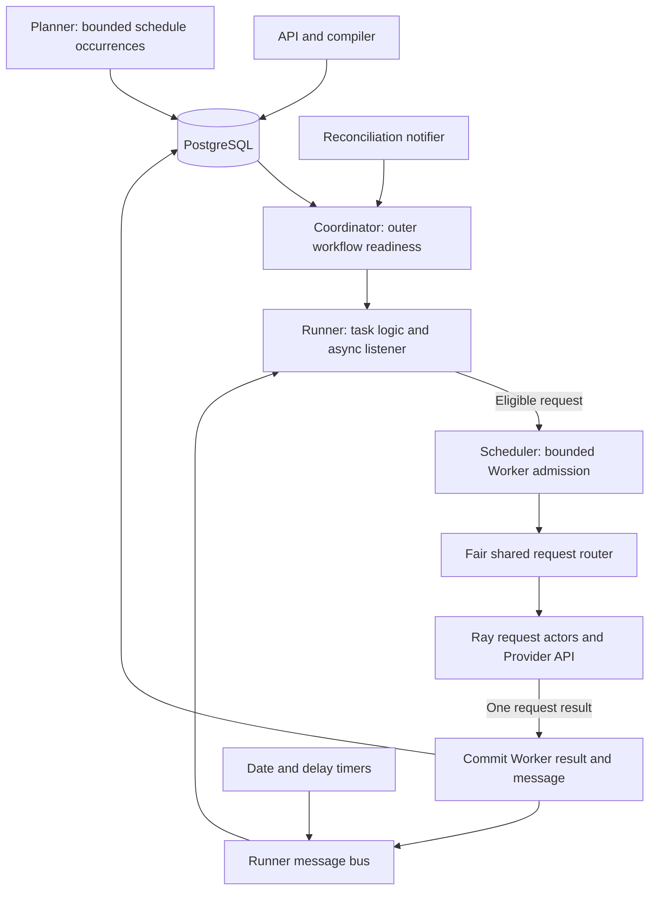
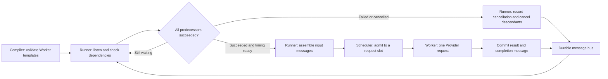

# Runtime, storage, and multi-turn execution

The Backend runs one runtime coordinator and one Scheduler. PostgreSQL stores accepted
work, execution intent, checkpoints, results, and message history. Runtime queues and Ray
actors manage live work. Tables live in the PostgreSQL schema selected by the connection
(normally `public`). There is no application schema-version marker. Readiness checks
required tables and columns; it does not validate every type, index, or constraint.
The previous protocol or Dispatch layout still requires a fresh database or an explicit
migration; changing a label cannot convert those tables.



A Runner owns one complete task, preparation, progression, and aggregate outcome. A Worker
executes one prepared Provider request. It owns no conversation loop, delay, or task state.
The Scheduler assigns physical request capacity only while that request executes.

`RunnerRuntime` listens asynchronously to a Runner-scoped durable mailbox. `WorkflowTaskLogic`
uses dependencies, committed outputs, and due times to select the next request. Pressure
and multi-turn tasks use the same lifecycle. A pending Scheduler submission does not block
the listener; at most one submission operation waits per Runner.

The separate `ReconcileNotifier` is a bounded, coalescing in-process hint queue. It may
lose hints; periodic coordinator reconciliation repairs them. It carries no Worker output
or conversation history. Planner materializes outer RunnerPlan occurrences and retains its
calendar, overlap, and misfire policies. Runner timers publish `timer.due` messages and
never submit Workers themselves.

Outer task `run` nodes create multi-request Runners; `invoke` creates a one-request Runner.
Both use the atomic request dispatcher. A batch advances its outer node only after its
aggregate outcome commits. Failed or cancelled batches terminate their instance and cancel
pending nodes and queued siblings; other instances continue independently.

## Capacity

```text
actor count = floor((ray_num_cpus - preparation_workers) / ray_actor_num_cpus)
request capacity = actor count × ray_actor_max_concurrency
```

The runtime performance guard can lower that capacity. Ray CPU resources determine actor
placement, while request slots measure HTTP operations in flight. Default settings give
eight actors and 64 request slots. Different Runners can share an actor; credentials,
messages, metrics, and adapter objects are isolated per request. Actors never change their
process environment to switch Providers.

`LLMPERF_RUNNERS_MAX` independently bounds active logical Runner handles. Its default is
64 so 64 independent atomic invokes can occupy all request slots. An existing explicit
value of 8 remains a limit of eight simultaneous one-request Runners. Ordinary Runners can
omit `concurrent_requests` to leave admission to Scheduler. An explicit value sets an
optional rolling ceiling on outstanding Workers, including queued and uncommitted results. The shared router fairly
rotates queued requests between Runners and enforces the global capacity across Campaigns.

```bash
llmperf-backend config set LLMPERF_RUNNERS_MAX 64
llmperf-backend config set LLMPERF_RAY_CPUS 8
llmperf-backend config set LLMPERF_RAY_ACTOR_CPUS 1
llmperf-backend config set LLMPERF_RAY_ACTOR_MAX_CONCURRENCY 8
llmperf-backend config set LLMPERF_MAX_RUNNER_CONCURRENCY 64
llmperf-backend config set LLMPERF_MAX_EFFECTIVE_CONCURRENCY 64
```

Apply settings before starting the updated Backend. Configuration does not submit work.
Scheduler status reports `live_slots` and `busy_slots` as request capacity and executing
requests, plus `active_runners` and `request_pool` details. Pool counts are sampled with Ray
health. Admission reports requested and effective concurrency separately when capacity
limits a workload.

Compiled invokes complete individually. There is no static group completion barrier.
Ready work shares actors at execution time, including requests from different instances.
Blocked turns, joins, and delays use no actor slot. Runner preparation and aggregation use a bounded local executor; Provider calls execute
in shared Ray actors. Tokenizers are cached by resolved path and mode, with serialized
initial loading. Workers never initialize a tokenizer or open PostgreSQL connections.
Ray execution retries and actor restarts remain disabled.

## Durable records

| Tables | Purpose |
|---|---|
| `benchmark_campaigns`, `benchmark_runner_plans` | Ownership, recurrence, durable control intent |
| `benchmark_task_definitions`, `benchmark_task_instances` | Recipes, compiled instance metadata, checkpoints and outcomes |
| `execution_nodes` | Durable node identities, dependencies, completed timing, and Runner linkage |
| `benchmark_runners`, `task_attempts` | Logical execution status and fenced execution attempt |
| `benchmark_request_results` | Request metrics and history-version references |
| `worker_steps` | Per-Runner request reservations, fenced status, and individual committed outputs |
| `runner_messages`, `runner_message_receipts` | Generic Runner mailbox and per-consumer acknowledgement |
| `conversation_messages` | Joined subclass of the generic message record, adding ordered role/content and conversation identity |
| `execution_leases` | Single active Backend owner, expiry and increasing fencing generation |
| Runner/plan event and identity tables | Lifecycle audit and authentication metadata |

`execution_nodes` replaces `benchmark_runner_dispatches`. Its pending/blocked fields
describe durable progress; SQL no longer decides graph readiness. Repository transactions
still verify payload identity and terminal state. Existing metadata table names remain
where their responsibilities are unchanged. Event tables remain purpose-specific audit
records, not a database message bus.

An attempt records one Runner execution. Each Worker result and its `worker.completed`
message commit together under that attempt's fencing generation. Message delivery is
acknowledged separately, after Runner progression. Batch summaries and exported request
metrics commit when aggregation completes.

This version does not resume an interrupted Runner from mailbox receipts. Its in-memory
progression decisions are not transactionally checkpointed with acknowledgement. Recovery
marks interrupted attempts and unfinished Worker reservations indeterminate, preserving
committed individual outputs without automatically resending requests. Do not treat the
mailbox as an exactly-once Provider execution guarantee.

## Worker templates and message reuse

`runner.inputs` defines named text/dataset inputs and new-input token budgets.
`runner.request` describes a finite execution and message-composition graph. Its default is one
Worker; `repeat` repeats the template or complete `steps` graph. `depends_on` describes
readiness, with optional `reuse_messages: true` on each source. Multi-turn conversations,
parallel independent requests, and merging several earlier message lists use these same
primitives. See [the definition rules](tasks.md#runner-data-and-request-logic),
[the multi-turn example](../examples/example-multiturn.yaml), and
[the merge example](../examples/example-message-merge.yaml).



The Runner owns dependency checks, failure propagation, timing, and input composition.
Workers do not wait for other Workers or schedule their successors. Scheduler owns slot
admission. Timer events and committed Worker outputs share the Runner message bus; the bus
stores and delivers data, without deciding whether to execute or cancel a request.

At startup and after each event, the Runner calculates eligibility. A root's `after`
starts when progression begins after preparation; a dependent step's `after` starts at
the latest predecessor completion. An optional `at` is another lower bound, so the later
instant wins. Runner arms one asynchronous timer for its earliest future eligible step.
`TimerSource.fire` waits without occupying a request slot and publishes `timer.due` when
the instant arrives. Runner then checks dependencies, timing, and cancellation again before
submission. A due event is a wakeup, not permission for the timer to execute a Worker.
The Runner cancels obsolete timers when the waiting work disappears.

`request.steps` currently exposes `after` and `at`. The internal bounded periodic timer
helper is not a YAML step option. RunnerPlan recurrence remains Planner-owned and creates
new Runners; latency-threshold triggers remain a planned extension.

Before each submission the Runner verifies all dependencies succeeded. A failed or cancelled
predecessor cancels its unsubmitted descendants immediately, including delayed steps and
message merges. `worker.cancelled` records the step, reason, and failed dependencies;
cancelled steps do not emit artificial request results. Independent branches can finish.
The triggering request failure remains visible in aggregate results. Outer TaskInstance
failure separately cancels pending sibling Runner nodes.

Each `worker.completed` payload stores the executed request's structured messages, response,
and metrics in one committed record. Reusing a source copies its complete input message list
and appends its assistant response. Multiple sources concatenate in declared dependency
order, preserving roles, structured content, and shared-ancestor duplicates. The current
user input is appended last. Wait-only dependencies contribute no messages. VertexAI's
single-prompt adapter rejects message reuse.

For outer workflows, `invoke.depends_on` uses the same primitive and reads committed atomic
Worker messages within its TaskInstance. `run.depends_on` only waits for node success; use
`request.steps` for message reuse within a multi-request Runner. Each repetition and each
TaskInstance has its own dependency identities. There is no named conversation object or
mutable global history shared by branches.

Resolved execution records retain the internal `benchmark` field; transient `input_messages`
is assembled from committed sources at dispatch. `prompt_hash` identifies the current user
input and `messages_hash` identifies the composed message list. The internal `history_version`
is the number of reused messages, not a mutable conversation version. Generic mailbox data
is authoritative; the retained `conversation_messages` SQL table/export field is a legacy
storage structure and is not populated by these definitions.

Accumulated input messages are not retokenized during sending. Full-history input counts
rely on Provider usage. Local output counting remains an explicit opt-in after execution.
The TaskLogic interface permits bounded dynamic step creation, but YAML currently defines
finite graphs only; persisted reservations cannot exceed the declared expansion. Automatic
Provider retries and restart replay are not enabled.

## Parallel preparation and Runner rounds

Request slots belong to the shared router, not to individual Workers. Ready requests
from different Runners can share one actor; `concurrent_requests`, when explicitly set, is the optional Runner's
ceiling; the default is no Runner window. Preparation and dependency waits do not reserve request slots.

For eight preparation processes plus eight request actors, configure:

```dotenv
LLMPERF_RAY_CPUS=16
LLMPERF_PREPARATION_WORKERS=8
LLMPERF_RUNNERS_MAX=8
LLMPERF_RAY_ACTOR_CPUS=1
LLMPERF_RAY_ACTOR_MAX_CONCURRENCY=8
LLMPERF_PREPARATION_CHUNK_SIZE=16
LLMPERF_PREPARATION_BUFFER_CHUNKS=8
```

Each preparation actor reserves one Ray CPU. Request actor count uses the remaining
CPU budget, so enabling preparation does not increase request capacity accidentally.
Preparation defaults to zero workers for existing installations. With it enabled,
ordinary bundled-sonnet and external `concatenate` workloads calibrate corpus token estimates once per Runner,
then generate deterministic chunks without further tokenizer calls. The preparation producer buffers bounded chunks, but the current Runner bridge materializes
the finite request plan before dispatch. Requests and results therefore consume memory
proportional to the Runner request target. Streaming admission is a remaining optimization;
this refactor has not established performance equivalence for large pressure workloads. A single Runner can use the preparation
pool; eight Runners are not required to use eight preparation actors.

The local input length is a calibrated estimate, with provenance in `prompt_evidence`.
Provider usage remains authoritative. External datasets use the existing loader and
memory-mapped index. Calibration samples at most 128 records, capped at 4,096 characters
each. Preparation then selects from the full corpus without tokenizing requests or
copying the corpus into Ray messages. The resulting character/token estimate can vary
in accuracy across languages and records. Dataset choice is entirely in `runner.inputs.<name>.dataset`;
use `dataset_prompt_mode: concatenate` with `shared_prefix_tokens` for prefix workloads.
External `sample` workloads, cache probes, and compiled
exact-replay/multi-turn tasks retain their existing exact preparation path. Their
payloads are not silently converted to estimated prompts. Worker logs remain buffered
until completion; scheduler status displays preparation capacity separately.


One YAML can repeat a set of Runner templates:

```yaml
campaign:
  name: cache-pressure
  rounds:
    count: 100
    seed: 20261014
runners: null
```

The Backend resolves templates once, expands and assesses the entire budget, and
persists all Runners atomically. Seeds derive from the explicit seed, round, and
template index. Chunk boundaries and actor scheduling do not change prompt content.
All members of a round must become terminal before the next round is eligible.
Failures remain visible in Campaign outcome; independent later rounds may continue.
Cancellation stops the entire Campaign. Recovery reconstructs barriers from durable
Runner status and `metadata.runner_round`; no extra database schema is needed.
This metadata field is reserved for Backend round expansion.

Round boundaries may have preparation/ramp-down gaps. A finite round count is not a
wall-clock duration or guaranteed continuous occupancy. An 80% shared prefix describes
offered reuse, not an observed cache-hit ratio. See [example-rounds.yaml](../examples/example-rounds.yaml).

## Recovery and cutover

The lease admits one active Backend even with an external Ray cluster. A new owner receives
a higher generation; stale owners cannot commit results. Interrupted executing attempts
become indeterminate and fail their Runner. Accepted work that never started remains
recoverable. No automatic Provider retry is introduced. Fencing cannot undo an HTTP request
already sent. Cancellation prevents queued calls from starting, while a running call keeps
its physical slot until execution ends.

Completed results awaiting commit remain bounded by Scheduler admission while a transient database
write failure is retried. Successors remain blocked until commit. A lost runtime lease
requires recovery under a new owner; it does not permit the old owner to continue writing.

Create a fresh database, initialize it with `sql/postgresql/init.sql`, point `DATABASE_URL`
to it, and restart the Backend after stopping the old service. Retain the old database
until its disposition is explicitly decided. `/health` and `llmperfctl health` distinguish
database connectivity from schema readiness; an incompatible schema cannot schedule work.
Initializing an existing incomplete layout fails instead of silently adding new tables.
The generic mailbox, receipts, Worker records, and joined conversation tables require a
fresh schema or an explicit migration from older installations. Removing a version-marker
table alone does not upgrade that layout. No live schema migration is performed by this
source change.
