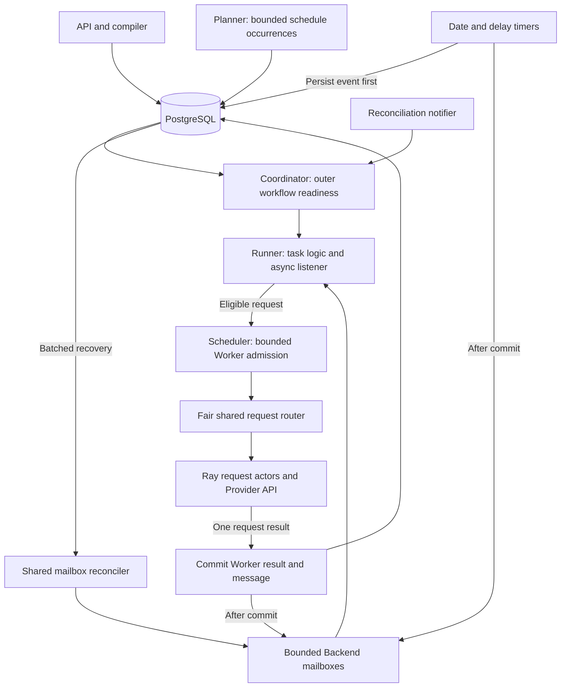
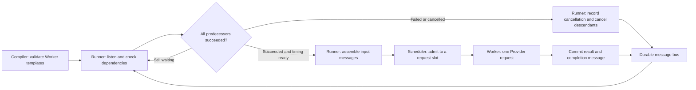
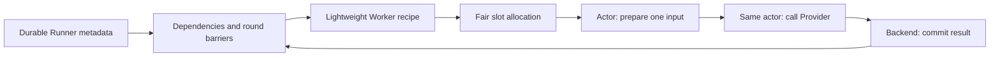

# Runtime, storage, and multi-turn execution

## Submission limits and rolling Runner admission

Every submission receives a durable `runtime_id`. Its optional top-level
`runtime.concurrent_workers` ceiling applies to all Workers produced by that
submission, whether it creates a Runner, a batch, a Campaign, or a RunnerPlan.
Omitting the ceiling allows use of all available Backend Worker quota. Child
submissions retain their parent's limit; a child ceiling can only tighten it.
`GET /api/v1/runtimes/{runtime_id}` returns the stored configuration and inherited limits.

```yaml
runtime: {concurrent_workers: 24}
campaign: {name: pressure}
# ... task definitions or Runners ...
```

Worker permits are acquired from child runtime to parent runtime, then from the
Backend pool. Waiting for a runtime quota does not reserve a physical Worker slot.
Cancellation retains permits until physical execution finishes.

A Runner's `concurrent_workers` bounds its own outstanding Workers. Its canonical
Worker template is `worker: {repeat: 156, every: 544}`. `every` is an optional
completion-relative cooldown, including after a failed Worker; it requires serial
execution and cannot be combined with explicit `steps` or `cache_probe`. Each Worker
remains an independent request, without retry or an added dependency edge.
Legacy input aliases `request` and `concurrent_requests` remain readable; serialization
and examples use `worker` and `concurrent_workers`.

Runners release active Runner admission during timed waits with no outstanding Worker.
Other Runners can take that slot. A due Runner rejoins the same admission queue, retaining
its seed, remaining repetitions, and original timeout. Waiting progression remains in
memory and in the durable mailbox; it is not automatically replayed after a restart.
The active Runner limit and physical Worker capacity stay independent.

## Compact storage and log files

PostgreSQL stores scheduling identities, state, counts, summaries, and log keys.
Detailed stdout/stderr live in immutable, content-addressed files under
`LLMPERF_LOG_DIRECTORY` (default `~/.local/state/llmperf/runner-logs`). Files are written
atomically before their key is committed. `LLMPERF_LOG_LIMIT` bounds each stream.
Persist this directory outside the container; `/runners/{id}/logs` reads the file
and checks its digest. Removed files return empty logs; their metadata remains usable.
Runner listings and exports carry the key rather than embedding log text.

Shared-worker Runners retain timestamped execution events in stdout: creation counts,
Worker admission/submission and completion, numeric latency/token metrics, dependency
cancellation, timeout, and final counts. Each Runner owns a bounded event buffer;
older events are dropped with an explicit truncation notice. These logs do not capture
global process streams or include prompts, generated text, credentials, or raw Provider
error bodies. Exceptions retain the existing stderr traceback path. Events are persisted
when the Runner finishes or is explicitly cancelled; `runner logs` is not a live stream.
An abrupt Backend stop can lose buffered events. Previously completed Runners with empty
logs cannot acquire these events retroactively; deploying this change requires a Backend
restart and a new run.

`workers` stores only reservation identity, generation, state, timestamps and a
completion digest. The durable `runner_messages` mailbox holds the sole full Worker
completion payload; no second request/result JSON copy is kept in the reservation row.
The separate result metrics remain available for benchmark analysis.

Campaign list progress uses grouped SQL totals and only merges live telemetry for
resident Runners. It does not transfer every historical Runner to Python or read log
files. A campaign/status index supports the summary query. These changes require a
fresh schema; follow the [cutover guidance](#recovery-and-cutover) for existing installations.


The Backend runs one runtime coordinator and one Scheduler. PostgreSQL stores accepted
work, execution intent, checkpoints, results, and message history. Runtime queues and Ray
actors manage live work. Tables live in the PostgreSQL schema selected by the connection
(normally `public`). There is no application schema-version marker. Readiness checks
required tables and columns; it does not validate every type, index, or constraint.
The previous protocol or Dispatch layout still requires a fresh database or an explicit
migration; changing a label cannot convert those tables.



A Runner owns lightweight Worker creation, progression, and aggregate outcome. A Worker
prepares input and executes one Provider request inside one Ray actor call. It owns no conversation loop, delay, or task state.
The Scheduler assigns physical request capacity only while that request executes.

`RunnerRuntime` listens asynchronously to a Runner-scoped durable mailbox. `WorkflowTaskLogic`
uses dependencies, committed outputs, and due times to select the next request. Pressure
and multi-turn tasks use the same lifecycle. A pending Scheduler submission does not block
the listener; at most one submission operation waits per Runner.

The shared dispatcher delivers the committed `RunnerMessage` directly to Backend mailbox
buffers. Each consumer/destination subscription retains at most 64 unacknowledged events;
the bound counts events, not payload bytes. PostgreSQL remains authoritative. A single
`MessageReconciler` repairs startup, dropped delivery, and buffer overflow every five
seconds, or on a recovery hint. It reads at most 64 mailboxes per query and one pending
event per mailbox per pass, using the existing destination and receipt indexes. Recovery
therefore makes progress for every subscribed Runner even if another has a backlog.
Acknowledging a recovered event requests another pass so a backlog drains without a
five-second pause between every recovered event.
Standalone buses retain their local recovery timer; Scheduler-managed buses do not run
individual database polling loops. A recovery read racing with an acknowledgment is
discarded for that subscription and retried on a later pass.

Runner progression acknowledges each processed message batch in one transaction. A failed
receipt write leaves the buffer intact. Delivery is at least once: consumers must use
stable event IDs and idempotent effects. Closing the last managed mailbox stops its
reconciler; Scheduler shutdown also stops it explicitly.

The separate `ReconcileNotifier` is a bounded, coalescing in-process hint queue. It may
lose hints; periodic coordinator reconciliation repairs them. It carries no Worker output
or conversation history. Planner materializes outer RunnerPlan occurrences and retains its
calendar, overlap, and misfire policies. Runner timers publish `timer.due` messages and
never submit Workers themselves.

For compiled tasks, reconciliation reads the pending dependency frontier and its
successful parent checkpoints, rather than materializing every future round. The
coordinator evaluates completion-relative delays and wave barriers from those
checkpoints. Periodic reads reconstruct this frontier after missed notifications.

Outer task `run` nodes create multi-request Runners; `invoke` creates a one-request Runner.
Both use the atomic request dispatcher. A batch advances its outer node only after its
aggregate outcome commits. Failed or cancelled batches terminate their instance and cancel
pending nodes and queued siblings; other instances continue independently.

## Capacity

```text
actor count = floor((ray_num_cpus - preparation_workers) / ray_actor_num_cpus)
request capacity = actor count × ray_actor_max_concurrency
```

The runtime performance guard can lower that capacity. Ray CPU resources determine actor
placement, while request slots cover both input preparation and Provider I/O. Default settings give
eight actors and 64 request slots. Different Runners can share an actor; credentials,
messages, metrics, and adapter objects are isolated per request. Actors never change their
process environment to switch Providers.

`LLMPERF_RUNNERS_MAX` independently bounds active logical Runner handles. Its default is
1024, independently of eight Backend aggregation threads. The coordinator's ready
queue uses the same budget, so increasing it also allows more task Runners to be
materialized and staged. Each created Runner is published immediately; execution
does not wait for the whole materialization batch. Materialization rotates across
ready task instances and yields after the reconciliation interval so new campaigns
are discovered while existing family pools are still being created. This does not increase request
actor capacity. An existing explicit
value of 8 remains a limit of eight simultaneous one-request Runners. Ordinary Runners can
omit `concurrent_workers` to leave admission to Scheduler. An explicit value sets an
optional rolling ceiling on outstanding Workers, including queued and uncommitted results. The shared router fairly
rotates queued requests between Runners and enforces the global capacity across Campaigns.

```bash
llmperf-backend config set LLMPERF_RUNNERS_MAX 1024
llmperf-backend config set LLMPERF_PREPARATION_THREADS 8
llmperf-backend config set LLMPERF_RAY_CPUS 8
llmperf-backend config set LLMPERF_RAY_ACTOR_CPUS 1
llmperf-backend config set LLMPERF_RAY_ACTOR_MAX_CONCURRENCY 8
llmperf-backend config set LLMPERF_MAX_RUNNER_CONCURRENCY 64
llmperf-backend config set LLMPERF_MAX_EFFECTIVE_CONCURRENCY 64
```

Apply settings before starting the updated Backend. Configuration does not submit work.
Scheduler status reports `live_slots` and `busy_slots` as request capacity and executing
requests, plus `active_runners` and `request_pool` details. Pool counts are sampled with Ray
health. Admission reports requested and effective concurrency separately when capacity
limits a workload.

Compiled invokes complete individually. There is no static group completion barrier.
Ready work shares actors at execution time, including requests from different instances.
Blocked turns, joins, and delays use no actor slot. Backend aggregation uses a bounded
executor. Shared Ray actors prepare and send each admitted Worker, caching tokenizers
by resolved path and mode. Actors never open PostgreSQL connections.
Ray execution retries and actor restarts remain disabled.

## Performance guard

**Static validation and runtime protection are on; campaign budget enforcement is
off by default.** Large Runner/request/token totals alone do not reject a campaign.
The Backend still calculates and reports all estimates.

`LLMPERF_PERFORMANCE_GUARD_ENABLED=true` controls runtime memory protection and the
router guard cap. `LLMPERF_CAMPAIGN_ADMISSION_ENABLED=false` independently makes
whole-submission budgets advisory. Omitting either setting retains its default.
Schema, type, range, dependency, finite-expansion, and static concurrency checks
remain enabled independently of these switches.

| Control | When it acts | Effect |
|---|---|---|
| Static validation and request limits | Before accepting work; also during Campaign artifact validation | Always reject invalid structure or request concurrency above configured limits |
| Campaign admission budgets | Before accepting a Runner, Campaign, or RunnerPlan; also during Campaign artifact validation | Always estimate whole-submission totals; reject excessive totals only when `LLMPERF_CAMPAIGN_ADMISSION_ENABLED=true` |
| Request capacity | While scheduling requests | Bound simultaneous requests through active Runner windows, shared Ray slots, and the router's guard cap |
| Host-memory breaker | During execution | Pause new Runner claims at high memory use and resume below the recovery threshold; already running requests are not cancelled |
| Ray health and object-store backpressure | During execution, independently of the main guard switch | Pause new Runner claims while Ray is unhealthy or its object store has too little available capacity |

### Submission settings and units

These are **packaged defaults**, not a claim about an existing deployment's overrides.
The names beginning with `MAX_CAMPAIGN` apply to the complete submission, including
standalone Runner and RunnerPlan submissions.

| Backend environment setting | Default | Meaning |
|---|---:|---|
| `LLMPERF_CAMPAIGN_ADMISSION_ENABLED` | false | Opt in to rejecting submissions that exceed the three campaign budgets below |
| `LLMPERF_MAX_CAMPAIGN_RUNNERS` | 1,000 | Advisory total expanded Runners, including compiled task nodes and bounded plan occurrences |
| `LLMPERF_MAX_CAMPAIGN_REQUESTS` | 10,000 | Advisory total planned Provider requests across all Runners |
| `LLMPERF_MAX_CAMPAIGN_TOKENS` | 100,000,000 | Advisory sum of estimated input and output tokens across all planned requests |
| `LLMPERF_MAX_RUNNER_CONCURRENCY` | 64 | Maximum estimated simultaneous request demand within one Runner |
| `LLMPERF_MAX_EFFECTIVE_CONCURRENCY` | 64 | Maximum estimated effective simultaneous request demand; also caps the shared request router |
| `LLMPERF_PERFORMANCE_WARNING_RATIO` | 0.8 | Warn when an estimate reaches 80% of its limit |

An estimate **strictly greater than** a static concurrency limit rejects admission.
The three whole-submission budget limits reject only with campaign admission
enabled. Equality is allowed. Warnings alone do not reject a workload.
Reducing concurrency can reduce live pressure without reducing total requests or
tokens. Splitting work across serial rounds also preserves its whole-campaign budget.
These totals are operator-defined workload budgets, not measurements of hardware
capacity or Provider context support.

For independent single-batch instances with fixed lengths and no reused history:

```text
Runners = input lengths × families per length × trials per family
requests = Runners × requests per Runner
estimated tokens = sum over lengths:
                   families × trials × requests per Runner × (input tokens + output tokens)
```

For example, four lengths, eight families, 32 trials, and 16 requests per Runner
expand to 1,024 Runners, exceeding the default 1,000-Runner budget even if only one
request runs at a time. This is advisory by default and rejects only after opting
in to campaign admission. With 31 trials, 32,768 / 131,072 / 524,288 / 819,200 input
tokens and 16 output tokens, the same shape has 992 Runners, 15,872 requests, and
5,981,331,456 estimated tokens. It fits a deployment configured for 204,800 requests
and 6,714,163,200 tokens, but exceeds the packaged request and token defaults.
The estimator also accounts for request-step dependencies and reused history;
use Backend validation for composed workloads.

`token_budget` is neither a maximum prompt length nor a live-memory estimate.
Input preparation may estimate tokens, and the Provider may use another tokenizer.
Passing the guard does not guarantee that an 800K target remains below 1M actual
tokens or that the Provider supports that context length.

### Runtime settings and independent switches

| Backend environment setting | Default | Meaning |
|---|---:|---|
| `LLMPERF_PERFORMANCE_GUARD_ENABLED` | true | Enable the host-memory breaker and router guard cap |
| `LLMPERF_MAX_HOST_MEMORY_UTILIZATION` | 0.90 | Pause new Runner claims at host memory used ratio >= 90% |
| `LLMPERF_RESUME_HOST_MEMORY_UTILIZATION` | 0.80 | Resume claims at host memory used ratio <= 80% |
| `LLMPERF_PERFORMANCE_SAMPLE_INTERVAL` | 1.0 | Seconds between host-memory samples |
| `LLMPERF_MIN_RAY_OBJECT_STORE_AVAILABLE_RATIO` | 0.10 | Pause new claims at Ray object-store free ratio <= 10% |
| `LLMPERF_RESUME_RAY_OBJECT_STORE_AVAILABLE_RATIO` | 0.20 | Resume claims at Ray object-store free ratio >= 20% |

Setting `LLMPERF_PERFORMANCE_GUARD_ENABLED=false` disables the router's configured
guard cap and the host-memory claim breaker. It does **not** change campaign
admission, static concurrency checks, structural YAML/compiler bounds, Runner
windows, `LLMPERF_RUNNERS_MAX`, physical Ray capacity, Ray health checks, or Ray
object-store backpressure. The object-store settings above still apply.

Assessments retain `safe`, `limits`, `risks`, and `warnings`, and expose
`campaign_admission_enabled` and `blocking_risks`. `safe=false` means an estimate
exceeds a configured threshold; it can be advisory. Only non-empty
`blocking_risks` reject a submission. With campaign admission off, excessive
whole-campaign totals appear in `risks` but not in `blocking_risks`.

Before this split, the single `enabled` switch also enforced campaign budgets.
After upgrading, existing numeric budget overrides remain available but are
advisory unless `LLMPERF_CAMPAIGN_ADMISSION_ENABLED=true` is explicitly set.
Keep it false to accept large campaigns without raising arbitrary total budgets.

### Inspecting and changing settings

Use `llmperfctl scheduler status --json` for the running guard's `enabled` and
host-memory `tripped` state, and `ray_runtime.claim_blocked` for object-store
backpressure. Status also shows `campaign_admission_enabled` and `workload_limits`,
and the human view labels runtime protection, campaign admission, campaign budgets,
and static concurrency limits separately. An older Backend that omits the new
field is shown as `Campaign admission: enabled=unknown`, never assumed disabled.
`enabled` is the setting; `tripped=false` only means the host-memory breaker is
not currently pausing new Runner claims.
An idle, untripped guard can still reject invalid structure or excessive concurrency,
and can reject campaign totals when campaign admission is explicitly enabled.

`llmperfctl campaign preview -f FILE` checks structure and expansion; it does not
prove budget acceptance. `llmperfctl campaign validate -f FILE` assesses the budget
and validates artifacts without submitting inference. In a 422 response, compare
each `performance_safety.risks` entry's `value` with its `limit`:
`blocking_risks` identifies which limits actually caused rejection.
`planned_runners_limit`, `provider_requests_limit`, and `token_budget_limit`
refer to the three optional whole-submission budgets. Some CLI versions redact
`token_budget` fields; the numeric `token_budget_limit` risk still shows the
rejected estimate and cap.

Persist settings in the Backend's selected environment file or use
`llmperf-backend config set NAME VALUE` as the Backend service user.
Process environment overrides file values; custom Backend YAML may specify
literal values instead of the packaged environment substitutions.
Restart the Backend to apply these changes; `llmperfctl provider reload` only
reloads Provider profiles. Check active work before a restart. Editing workload
YAML does not change an already accepted campaign.

## Durable records

| Tables | Purpose |
|---|---|
| `runtimes` | Submission identity, parent scope, and Worker quota configuration |
| `campaigns`, `runner_plans` | Ownership, recurrence, durable control intent |
| `task_definitions`, `task_instances` | Recipes, compiled instance metadata, checkpoints and outcomes |
| `execution_nodes` | Durable node identities, dependencies, completed timing, and Runner linkage |
| `runners`, `runner_attempts` | Logical execution status and fenced execution attempt |
| `worker_results` | Request metrics and history-version references |
| `workers` | Worker identity, reservation state, timing, and completion digest |
| `runner_messages`, `runner_message_receipts` | Generic Runner mailbox and per-consumer acknowledgement |
| `conversation_messages` | Joined subclass of the generic message record, adding ordered role/content and conversation identity |
| `execution_leases` | Single active Backend owner, expiry and increasing fencing generation |
| Runner/plan event and identity tables | Lifecycle audit and authentication metadata |

`execution_nodes` replaces `benchmark_runner_dispatches`. Its pending/blocked fields
describe durable progress; SQL no longer decides graph readiness. Repository transactions
still verify payload identity and terminal state. Table names use concise plural domain
nouns without the redundant `benchmark_` prefix. Event tables remain purpose-specific audit
records, not a database message bus.

An attempt records one Runner execution. Each Worker result and its `worker.completed`
message commit together under that attempt's fencing generation. Message delivery is
acknowledged separately, after Runner progression. Batch summaries and exported request
metrics commit when aggregation completes.

This version does not resume an interrupted Runner from mailbox receipts. Its in-memory
progression decisions are not transactionally checkpointed with acknowledgement. Recovery
marks interrupted attempts and unfinished Worker reservations indeterminate, preserving
committed individual outputs without automatically resending requests. Do not treat the
mailbox as an exactly-once Provider execution guarantee.

## Worker templates and message reuse

`runner.inputs` defines named text/dataset inputs and new-input token budgets.
`runner.worker` describes a finite execution and message-composition graph. Its default is one
Worker; `repeat` repeats the template or complete `steps` graph. `depends_on` describes
readiness, with optional `reuse_messages: true` on each source. Multi-turn conversations,
parallel independent requests, and merging several earlier message lists use these same
primitives. See [the definition rules](tasks.md#runner-data-and-request-logic) and
[the multi-turn merge example](../examples/example-message-merge.yaml).



The Runner owns dependency checks, failure propagation, timing, and input composition.
Workers do not wait for other Workers or schedule their successors. Scheduler owns slot
admission. Timer events and committed Worker outputs share the Runner message bus; the bus
stores and delivers data, without deciding whether to execute or cancel a request.

At startup and after each event, the Runner calculates eligibility. A root's `after`
starts when progression begins before input preparation; a dependent step's `after` starts at
the latest predecessor completion. An optional `at` is another lower bound, so the later
instant wins. Runner arms one asynchronous timer for its earliest future eligible step.
`TimerSource.fire` waits without occupying a request slot and publishes `timer.due` when
the instant arrives. Runner then checks dependencies, timing, and cancellation again before
submission. A due event is a wakeup, not permission for the timer to execute a Worker.
The Runner cancels obsolete timers when the waiting work disappears.

`worker.steps` currently exposes `after` and `at`. The internal bounded periodic timer
helper is not a YAML step option. RunnerPlan recurrence remains Planner-owned and creates
new Runners; latency-threshold triggers remain a planned extension.

Before each submission the Runner verifies all dependencies succeeded. A failed or cancelled
predecessor cancels its unsubmitted descendants immediately, including delayed steps and
message merges. `worker.cancelled` records the step, reason, and failed dependencies;
cancelled steps do not emit artificial request results. Independent branches can finish.
The triggering request failure remains visible in aggregate results. Outer TaskInstance
failure separately cancels pending sibling Runner nodes.

Each `worker.completed` payload stores the executed request's structured messages, response,
and metrics in one committed record. Reusing a source copies its complete input message list
and appends its assistant response. Multiple sources concatenate in declared dependency
order, preserving roles, structured content, and shared-ancestor duplicates. The current
user input is appended last. Wait-only dependencies contribute no messages. VertexAI's
single-prompt adapter rejects message reuse.

For outer workflows, `invoke.depends_on` uses the same primitive and reads committed atomic
Worker messages within its TaskInstance. `run.depends_on` only waits for node success; use
`worker.steps` for message reuse within a multi-request Runner. Each repetition and each
TaskInstance has its own dependency identities. There is no named conversation object or
mutable global history shared by branches.

Resolved execution records retain the internal `benchmark` field; transient `input_messages`
is assembled from committed sources at dispatch. `prompt_hash` identifies the current user
input and `messages_hash` identifies the composed message list. The internal `history_version`
is the number of reused messages, not a mutable conversation version. Generic mailbox data
is authoritative; the retained `conversation_messages` SQL table/export field is a legacy
storage structure and is not populated by these definitions.

Accumulated input messages are not retokenized during sending. Full-history input counts
rely on Provider usage. Local output counting remains an explicit opt-in after execution.
The TaskLogic interface permits bounded dynamic step creation, but YAML currently defines
finite graphs only; persisted reservations cannot exceed the declared expansion. Automatic
Provider retries and restart replay are not enabled.

## Actor preparation and Runner rounds

Runner activation creates lightweight descriptions. The dispatcher records each
single-send reservation and the router fairly assigns a physical slot before the
request actor prepares that Worker's input. One Ray invocation then prepares,
sends, normalizes, and returns; Backend persists the result. Dependencies and timers
remain outside actors. No actor executes an entire Runner loop.

Each actor has one CPU preparation lane and can overlap Provider I/O across its
request slots. Prefix/calibration caches are bounded and keyed by input settings,
resolved dataset/tokenizer and family seed. Trials and request indices determine
suffixes independently of actor placement. Calibrated counts remain estimates;
Provider usage is authoritative. Sample, literal, atomic, named-input and cache-probe
recipes also prepare inside their admitted actor call. See [limitations](limitations.md)
for generation compatibility, deadlines, cancellation, cache bounds and telemetry.

The existing CPU layout remains compatible:

```dotenv
LLMPERF_RAY_CPUS=16
LLMPERF_PREPARATION_WORKERS=8
LLMPERF_RUNNERS_MAX=1024
LLMPERF_RAY_ACTOR_CPUS=1
LLMPERF_RAY_ACTOR_MAX_CONCURRENCY=8
```

This places eight request actors. The legacy preparation-worker count retains CPU
headroom in capacity calculation; no separate preparation actors or chunk-prefetch
queues are launched for Backend Workers. Standalone benchmark helpers retain their
legacy preparation APIs.



One YAML can repeat a set of Runner templates:

```yaml
campaign:
  name: cache-pressure
  rounds:
    count: 100
    seed: 20261014
runners: null
```

The Backend resolves templates once, expands and assesses the entire budget, and
persists all Runners atomically. Seeds derive from the explicit seed, round, and
template index. Chunk boundaries and actor scheduling do not change prompt content.
All members of a round must become terminal before the next round is eligible.
Failures remain visible in Campaign outcome; independent later rounds may continue.
Cancellation stops the entire Campaign. Recovery reconstructs barriers from durable
Runner status and `metadata.runner_round`; no extra database schema is needed.
This metadata field is reserved for Backend round expansion.

Round boundaries may have preparation/ramp-down gaps. A finite round count is not a
wall-clock duration or guaranteed continuous occupancy. An 80% shared prefix describes
offered reuse, not an observed cache-hit ratio. See [example-matrix-phases.yaml](../examples/example-matrix-phases.yaml).

## Recovery and cutover

The lease admits one active Backend even with an external Ray cluster. A new owner receives
a higher generation; stale owners cannot commit results. Interrupted executing attempts
become indeterminate and fail their Runner. Accepted work that never started remains
recoverable. No automatic Provider retry is introduced. Fencing cannot undo an HTTP request
already sent. Cancellation prevents queued calls from starting, while a running call keeps
its physical slot until execution ends.

Backend maintenance renews the ownership lease in a short exclusive transaction every
five seconds. Ordinary fenced writes hold a shared lease-row lock through commit, so
unrelated Runners can write concurrently while ownership takeover still waits for those
transactions. Read-only task-readiness snapshots validate ownership without holding that
lock over the dependency scan. Expired ownership cannot be renewed.

The same maintenance task checks cancellation in batches of at most 128 Runners at the
Scheduler polling cadence (capped at five seconds). Heartbeat timestamps refresh every
five seconds, or one third of the stale threshold when shorter. Refresh skips rows already
locked by other transactions; a skipped row is not interpreted as cancellation. Waiting
Runners receive in-memory cancellation events rather than polling PostgreSQL themselves.
Maintenance failure stops admission and execution supervision; it never authorizes replay.

These mailbox and maintenance changes use the existing schema. Updating an installation
that already has these tables requires a Backend restart, not a database rebuild.

Completed results awaiting commit remain bounded by Scheduler admission while a transient database
write failure is retried. Successors remain blocked until commit. A lost runtime lease
requires recovery under a new owner; it does not permit the old owner to continue writing.

Create a fresh database, initialize it with `sql/postgresql/init.sql`, point `DATABASE_URL`
to it, and restart the Backend after stopping the old service. Retain the old database
until its disposition is explicitly decided. `/health` and `llmperfctl health` distinguish
database connectivity from schema readiness; an incompatible schema cannot schedule work.
Initializing an existing incomplete layout fails instead of silently adding new tables.
The generic mailbox, receipts, Worker records, and joined conversation tables require a
fresh schema or an explicit migration from older installations. Removing a version-marker
table alone does not upgrade that layout. No live schema migration is performed by this
source change.
