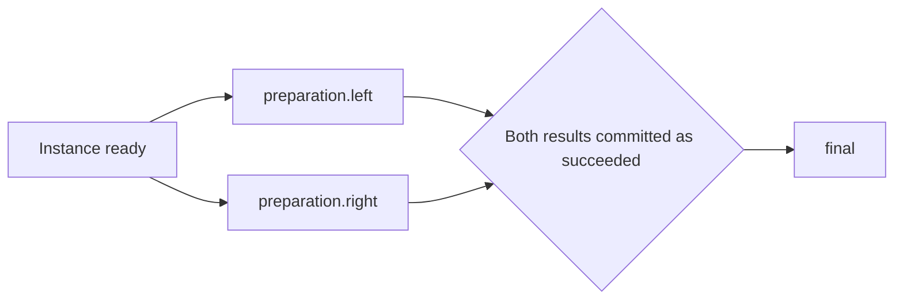

# Task compiler and YAML definition rules

LLMPerf 1.0.0 compiles finite task definitions into dependency graphs before execution.
Use `instances` to create independent copies of a workflow, `workflow` to describe their
operations, and `runner` to configure the Runner created by each execution node.
The compiler supports both single-request `invoke` nodes and multi-request `run` nodes.

This is the current implementation contract as of October 21, 2026. For setup and commands,
see [Usage](usage.md); for runnable workloads, see [Examples](examples.md); for request
capacity, storage, and recovery, see [Runtime](runtime.md).

## Definition structure

A Campaign accepts `task_definitions` alongside immediate `runners` and `runner_plans`.
`campaign.rounds` is a separate mode restricted to immediate Runner templates; it cannot
be combined with task definitions or RunnerPlans.

```yaml
version: 1.0.0
campaign:
  name: independent-batches
wait: true
task_definitions:
- name: families
  instances:
    matrix:
      family:
      - 1
      - 2
    trials: 2
    seed: 20261014174544
  workflow:
  - run:
      name: batch
  runner:
    label: family
    timeout: 60
    concurrent_workers: 2
    model: spark-x2.5-4b-L4
    mean_output_tokens: 8
    stddev_output_tokens: 0
    provider: dfs-chat
    inputs:
      default:
        shared_prefix_tokens: 96
        tokens: 128
    worker:
      repeat: 4
```

Select a configured Provider and exact model before submission. URLs, credentials, and
adapter selection belong to Backend Provider Profiles. `wait` controls CLI observation;
it is removed before API validation.

| Field | Meaning |
|---|---|
| `name` | Definition name, 1–200 characters |
| `instances` | One expansion object containing `matrix`, `trials`, and `seed` |
| `payloads` | Named atomic payload definitions; may be omitted for batch-only workflows |
| `workflow` | Nonempty list of operations executed by every instance |
| `runner` | Shared Runner template: label, metadata, execution settings, and `worker` template |

Unknown fields are rejected. The former flat `sequence`/`kind` syntax and the input names
`seed_namespace`, `after_seconds`, `every_seconds`, `timeout_seconds`, and
`max_completed_requests` are no longer accepted. The nested
`sequence` workflow primitive remains supported.

## Runner data and request logic

### Seed pools and repeated groups

Use `parallel.count` and `parallel.node` to repeat a branch template without listing
every branch. This is compiler expansion with the same join semantics as explicit
`parallel.branches`. Specify either form, never both. Count accepts an integer or
`$dimension` reference, from 1 to 10,000; the expanded graph still has a 10,000-node
limit per instance. Nested nodes may be runs, invokes, sequences, or repeats.

```yaml
instances:
  seed: 20261021
workflow:
  - repeat:
      name: rounds
      count: 16
      node:
        parallel:
          name: members
          count: 512
          node:
            run:
              name: batch
              prefix_seed:
                pick:
                  seed: 2026102100
                  count: 1024
```

This expands to 8,192 batch Runners with a 1,024-seed pool. Increase the pool
independently of Runner count for more prefix variety. Each
Runner selects once and retains its chosen prefix for every request in its batch.
There is no new runtime round object: `rounds` and `members` are ordinary node names.
Each group waits for the previous group's successful completion within its instance.
A failed node terminates that instance, following existing task failure semantics.
Separate instances progress independently. Use `instances.trials` around one parallel
group for independent groups without a cross-group barrier.

`run.prefix_seed` accepts an unsigned 64-bit integer, a `$dimension` reference, or
`{pick: [integer, ...]}` or `{pick: {seed: 2026102100, count: 1024}}`.
The pick pool contains 1–10,000 unique unsigned 64-bit integers. The compact form
generates the pool from its parent `seed`; it is equivalent to supplying those
generated values as an explicit list. It does not add a runtime operation.
Selection is deterministic **with replacement**: duplicate selections are
allowed within and across groups. Pool size does not imply full coverage or equal
visit counts. To enumerate a pool exactly inside a shared wave, use `for_each`.
A matrix with `prefix_seed: $family` instead creates independent instances.

The `prefix-pool-v1` generator hashes `prefix-pool-v1`, parent seed, and zero-based
entry index, separated by NUL characters, with SHA-256. Each value is the first
eight digest bytes interpreted as an unsigned big-endian integer. In the unlikely
event of a collision, increment modulo 2^64 until the value is unused. The same
parent seed and count reproduce the same list; increasing count preserves earlier
entries. Changing the parent seed creates a different pool. Changing
`instances.seed` changes selection and suffixes without changing pool membership.
Increasing pool size can change selections because the selection modulus changes.
The recipe retains the compact definition; resolved seeds appear in debug preview
and persisted Runners as usual. YAML anchors can share a pool specification.

The `prefix-pick-v1` algorithm hashes the task seed, sorted matrix coordinates,
trial index, and expanded node path with SHA-256; the digest modulo pool length
selects a list position. Reordering the list changes the mapping. UUIDs, wall time,
actor placement, and execution order do not participate. The selected integer goes
directly to prefix generation, without mixing in round, Runner, or input names.
`run.prefix_seed` overrides `instances.prefix_seed_scope` for that run's prefix;
the existing batch/family suffix derivation remains separate and unchanged.
By default suffix seeds include task seed, matrix coordinates, trial index, and
expanded Runner path; each request adds its index. Selecting the same prefix in a
later trial or round therefore does not reset suffix generation. Tiny or repetitive
corpora can still produce identical text by chance; this is not a uniqueness filter.
Omitting it preserves existing behavior. Atomic `invoke` payload semantics are unchanged.

Keep dataset revision, adapter, tokenizer, prefix length, and generation path fixed
to reproduce prefix text. Literal inputs and zero-length prefixes do not gain reuse
from a seed. Equal prefix hashes prove local reuse, not memory or DFS cache hits.

Preview with `campaign preview -f FILE --debug` to inspect `prefix_seed` and the
separate `dataset_seed` on expanded runs. The selected seed persists in the Runner's
`shared_prefix_seed` and task context with `prefix_seed_version: explicit-prefix-v1`.
Validation and token/concurrency estimates count all expanded Runners and requests.
Group joins retain ordinary dependencies: R groups of N single-run branches require
(R−1)×N² dependency edges. Independent groups avoid that global join cost when no
barrier is needed. Counts bound work, not elapsed duration or cache retention.

See [the small runnable seed-pool example](../examples/example-seed-pool.yaml).

### Input and request configuration

A Runner owns a complete execution: the Provider, model, tokenizer, output and sampling
settings, named inputs, timeout, progress, and aggregate outcome. `worker` controls how
Workers are created and combined. A Worker executes one fully resolved Provider request;
it inherits its Runner's execution settings and selects one named input.

```yaml
runner:
  provider: aliyun
  model: deepseek-v4-pro
  tokenizer:
    id: deepseek-ai/DeepSeek-V3
  mean_output_tokens: 16
  stddev_output_tokens: 0
  additional_sampling_params:
    temperature: 0
  timeout:
    value: 2
    unit: m
  concurrent_workers: 8
  inputs:
    opening:
      tokens: 1024
    followup:
      tokens:
        mean: 64
        stddev: 8
  worker:
    repeat: 2
    steps:
    - name: first
      input: opening
    - name: next
      input: followup
      depends_on:
      - step: first
        reuse_messages: true
      after:
        value: 500
        unit: ms
```

Named inputs live under `runner.inputs`. An input can contain literal `text`, or dataset
and generated-input settings: `tokens`, `shared_prefix_tokens`, `dataset`,
`dataset_prompt_mode`, `dataset_repeat_count`, and `dataset_seed`. Omit text and dataset to
use the bundled corpus. `tokens: 128` means a fixed generation target; the object form
specifies `mean` and `stddev`. It describes **new input only**, excluding reused messages.
Literal text is sent as supplied and measured during preparation; a token target does not
truncate or pad it. Full-context usage comes from the Provider.

`dataset_repeat_count` controls dataset-record reuse within the planned requests, not
Worker count. In `sample` mode, six requests with a value of `2` select three records,
use each twice, and shuffle the resulting sequence. The default `1` selects each record
once. `concatenate` mode requires `1`, so the field can be omitted in that mode.

`worker.input` selects a named input and defaults to `default`. A step's `input` overrides
that selection. If every step selects its own input, no `default` entry is needed. Omitted
Runner inputs use Backend input defaults. Unknown input references fail validation.
Provider/model/tokenizer, sampling, output settings, and input data are not fields of
`worker` or its steps.

Omitting `worker` is equivalent to `worker: {}`: one Worker using the `default` input,
with no dependencies or delay. Backend data and execution defaults still apply.
Omitting `repeat` and `steps` plans one Worker. `repeat: 256` plans 256 independent Workers
using the selected input. With `steps`, `repeat` copies the entire graph: the example above
plans four Workers, with each follow-up scoped to its own opening request. Copies are
independent. The outer workflow `repeat` primitive instead sequences Runner nodes.
Repetition is planned work, never an automatic retry.

Each step defines `name`, optional `input`, `depends_on`, `after`, and `at`. Root delays
start when Runner progression begins after preparation; dependent delays start at the latest
predecessor completion. `at` must include a UTC offset. Both timing conditions must pass.

```yaml
depends_on:
  - step: analysis
    reuse_messages: true
  - step: review
    reuse_messages: true
  - step: ready
```

Every dependency must name an earlier step and succeed with a committed result.
`depends_on: [ready]` is wait-only shorthand. Marked sources contribute their actual
structured request messages followed by their assistant response. The Runner concatenates
them in declared order, then appends the current input. Completion order does not affect
message order. Shared ancestors and identical messages are retained, including duplicates;
there is no implicit deduplication or role rewriting. Wait-only sources add no messages.
A Runner sampling `messages` override cannot combine with message reuse.

The Runner checks predecessor outcomes before every submission. If one fails or is
cancelled, it records `worker.cancelled` and cancels unsubmitted descendants, including
delayed and message-merge steps. They make no Provider call and cannot use partial inputs.
Independent steps may continue. The original failed request remains in the Runner's failed
aggregate result. TaskInstance failure separately cancels pending sibling Runner nodes.

Worker results commit as `worker.completed` messages. The same Runner listener consumes
these outputs and `timer.due` events, then decides progression. Neither Workers nor the
message bus directly launch successors. Waiting consumes no request slot. An omitted
`concurrent_workers` leaves admission to Scheduler; an explicit value bounds outstanding
Workers. `timeout` covers execution after preparation, queueing, and inter-step waits.

The old authoring keys `benchmark`, `max_submissions`, `request_steps`, `history_from`, and
`conversation` have no aliases. Resolved Backend execution records retain the internal
`benchmark` shape, including unit-specific fields and flattened input defaults.
`message_sources` in previews is derived from `depends_on`, not authored separately.
The `request.cache_probe` adapter defines its own graph and cannot combine with explicit
steps, repetition, or literal input text.

## Instances, workflows, and Runners

```text
Definition: family=[1, 2], trials=2
├── Instance family=1;trial=0
│   └── workflow: run batch → one Runner → up to four requests
├── Instance family=1;trial=1
│   └── workflow: run batch → one Runner → up to four requests
├── Instance family=2;trial=0
│   └── workflow: run batch → one Runner → up to four requests
└── Instance family=2;trial=1
    └── workflow: run batch → one Runner → up to four requests
```

The matrix is a Cartesian product of named integer lists. Dimension names are expanded in
sorted order; values retain their listed order. `trials` creates independent samples at
each coordinate, with zero-based trial indices. An empty or omitted matrix contributes
one coordinate. Defaults are `trials: 1` and `seed: 11111`.

```text
instance count = product of matrix dimension lengths × trials
Runner count   = number of expanded run and invoke nodes across all instances
request target = sum(batch request targets) + number of invoke nodes
```

`family` has no reserved scheduling meaning. It labels a coordinate and contributes to
seed derivation. It does not allocate slots, share prefixes automatically, or impose order.
Every instance receives the whole workflow. Distinct instances have independent progress,
failure boundaries, payload checkpoints, and message sources.

Multiple `run` nodes use the same definition-level Runner template. Per-node benchmark,
Provider, model, or concurrency overrides are unsupported; use separate definitions when
templates differ. The compiler derives each node's `dataset_seed` and internal
`task_context`; do not supply internal context fields in authoring YAML.

## Workflow primitives

Each workflow item must contain exactly one primitive. Structural nodes compose other
nodes but do not themselves create Runners.

| Primitive | Required fields | Optional fields | Execution |
|---|---|---|---|
| `run` | `name` | `role`, `after`, `depends_on`, `prefix_seed` | One batch Runner using the template's request count and concurrency |
| `invoke` | `name`, `payload` | `role`, `after`, `depends_on` | One Runner with exactly one request and concurrency one |
| `repeat` | `name`, `count`, `node` | `every` | Serial expansion of the nested node |
| `parallel` | `name`, either `branches` or `count` plus `node` | `after` | Branches share incoming dependencies; the next step joins all branches |
| `sequence` | `name`, `steps` | `after` | Nested ordered operations |
| `for_each` | `name`, `variable`, `values`, `node` | `parallelism` (default 1), `after` | Enumerate values once in bounded serial lanes, then join all lanes |

Names contribute to logical node paths; `role` is analysis metadata and defaults to the
execution node's name. Roles do not influence scheduling. `run` accepts neither `payload`
or message-reusing dependencies. `invoke` must reference a declared payload. Task Runner templates
cannot contain `cache_probe`.

### Fixed cohorts with bounded parallelism

Use `for_each` to enumerate a fixed list or generated seed pool, rather than sample
it with replacement. Reusing this definition in later waves reuses the exact cohort:

```yaml
workflow:
  - for_each: &cohort
      name: cohort
      variable: prefix
      values: {seed: 202610211102, count: 256}
      parallelism: 32
      node:
        run: {name: request, prefix_seed: $prefix}
  - repeat:
      name: recalls
      count: 3
      every: {value: 40, unit: m}
      node:
        for_each: *cohort
```

`values` accepts 1–10,000 unique unsigned 64-bit integers or the same `{seed, count}`
generator used by `pick`. `parallelism` is an integer from 1 to 10,000; fewer values
produce fewer lanes. Values keep their list order and are split into contiguous,
balanced lanes; earlier lanes receive any extra members. For example, five values
with parallelism two produce serial lanes of three and two members.

Each lane waits for the incoming dependencies and optional `after` delay. Members
inside it execute serially; the following workflow node waits for every lane tail.
`parallelism` bounds simultaneous child subgraphs, not requests inside each child:
32 lanes of single-request `run` nodes cap requests at 32, but nested parallel nodes
or multi-request Runners can increase that bound. Safety estimates include them.

The variable binds `$prefix` only inside `node`, including nested counts, delays,
and prefix references. It must be a valid identifier and cannot shadow a matrix
dimension or enclosing loop variable. It does not interpolate arbitrary strings.
Sibling loops may reuse the same variable name. Matrix references remain available.

This expands at compilation into ordinary dependencies, with no runtime loop or
new Scheduler limit. Generated paths include `cohort.lane_01.member_01.request`.
Seeds selected explicitly for prefixes remain identical across waves; suffix seeds
still include each full Runner path and trial. Rewriting an existing explicit graph
can change suffix seeds because its paths change. Graph size, depth, and planned-span
limits still apply. Failures retain existing task-instance failure semantics.

### Sequential batches

Top-level workflow entries are an implicit sequence:

```yaml
workflow:
  - run: {name: first}
  - run: {name: second}
```

Within each instance, `second` waits for `first` to finish with committed Runner status
`succeeded`. Other instances can advance independently. With 800 instances, this creates
1,600 Runners; at 256 requests per Runner, the target is 409,600 requests.

### Parallel batches and joins

```yaml
workflow:
  - parallel:
      name: preparation
      branches:
        - run: {name: left}
        - run: {name: right}
  - run: {name: final}
```



The final node waits for both branches. Parallel means eligible concurrently, not guaranteed
simultaneous start. Branches still compete for bounded Runner and request capacity.
Keep the Mermaid source when editing this graph so Markdown viewers can render it.

### Serial repeats and nested sequences

```yaml
workflow:
  - repeat:
      name: rounds
      count: 2
      every: 1
      node:
        sequence:
          name: checks
          steps:
            - run: {name: first}
            - run: {name: second}
```

This expands to `rounds.1.checks.first → rounds.1.checks.second →
rounds.2.checks.first → rounds.2.checks.second`. Repeat indices start at one.
`repeat` is always serial; it has no parallel mode. A zero repeat emits no execution nodes
and passes its incoming dependency frontier through to the next step.

`every` is a completion-anchored delay before each iteration, including the first;
it is not a fixed start-to-start cadence. Execution duration and queue delay add to it.

### Dimensions and delay expressions

`count` accepts integer literals or `$dimension_name` references. Durations use `after`,
`every`, `timeout`, and cache-probe `delay`. A bare number means seconds; an object selects an
explicit unit (`ms`, `s`, `m`, `h`, or `d`). Fractional values are supported:

```yaml
after: 0.5                         # half a second
every: {value: 500, unit: ms}       # also half a second
```

Task durations can reference a matrix dimension as `after: $pause` (seconds) or
`after: {value: $pause, unit: ms}`. Referenced dimensions must exist in
`instances.matrix`. Durations must be finite and nonnegative. RunnerPlan intervals must
be positive; their `every` follows a fixed schedule, while task repeats remain
completion-relative. Cache-probe `delay` uses the same syntax and retains its 60-second
maximum.

The compiler converts durations to floating-point seconds. Internal graph fields and
preview output retain names such as `after_seconds` and `delay_seconds` to state the unit
of the converted value. These are output/internal names, not accepted authoring aliases.

This is not a general
template language: node names and Runner benchmark fields do not interpolate dimensions;
arithmetic, range expressions, and runtime result references are unsupported.

For a root node, delay starts at instance creation. For a dependent node, it starts at the
latest recorded completion of its predecessors. Atomic nodes use recorded request
completion; batches use aggregate completion. Parent results must be committed before
successors become eligible. Nested structural delays add at the relevant entry frontier.

## Choosing the current pressure workload structure

The compact structure is eight matrix values, `trials: 100`, and one `run: {name: batch}`.
It creates 800 independent TaskInstances and 800 immediately eligible batch nodes.
With the existing 256-request template, its target is 204,800 requests.

| Structure | TaskInstances | Nodes per instance | Ordering and failure scope |
|---|---:|---:|---|
| Eight families × 100 trials × one run | 800 | 1 | Independent batches; failure isolated to one trial |
| Eight families × one trial × 100 parallel runs | 8 | 100 | Concurrent branches within each instance; failure can cancel queued siblings |
| Eight families × one trial × repeat count 100 | 8 | 100 | Serial batches per family; failure prevents later batches |

These forms can have the same total request budget while differing in seeds, instance
metadata, readiness, and failure behavior. Changing structure is not an exact payload replay.

The `test-dcu-11` configuration inspected on October 16, 2026 allowed eight active Runners
and 64 request slots. Those are deployment settings, not compiler constants. Making all
800 batches eligible does not activate 800 Workers or randomly mix requests across all
800 prefixes. Each active batch still concentrates its requests on its own shared prefix.
The ready queue provides Campaign fairness, and the request router rotates among waiting
Runners; neither promises random selection or fairness between matrix coordinates.

## Seeds, prefixes, and replay

For run-only workflows, `instances.prefix_seed_scope: family` keeps the prefix seed
fixed across trials of one matrix coordinate. Suffix seeds derive from that family
seed, trial index, and node path. Named inputs namespace the prefix by input name.
The default `trial` scope retains the algorithm below. Neither mode shuffles
submission or implements fairness in Runner/trial logic.
See [limitations](limitations.md) for creation, queue, deadline, and cache boundaries.
An explicit `run.prefix_seed` overrides prefix derivation and input-name namespacing;
see [seed pools and repeated groups](#seed-pools-and-repeated-groups). The suffix seed
continues to vary by trial and expanded node path.

Batch seeds use the `batch-v1` algorithm:

```text
SHA-256("batch-v1" + task seed + sorted coordinates + trial index + node path)
→ first eight digest bytes interpreted as an unsigned big-endian integer
```

The implementation separates these fields with NUL characters. Coordinates are serialized
as sorted `key=value` pairs separated by semicolons. Reusing the same recipe and immutable
artifacts reproduces the generated inputs. Changing a matrix coordinate, trial index,
node name, nesting, or task seed changes seed derivation. Different seeds do not guarantee
disjoint corpus records or cache misses. Definition names and Runner labels are not seed
inputs.

For a batch with `shared_prefix_tokens`, requests reuse one generated prefix while suffixes
vary. A subsequent `run` node has a different seed because its path differs. With preparation
workers enabled, prompt token budgets are estimates; Provider usage is authoritative.

Atomic payload seeds instead depend on task seed, sorted coordinates, trial index, and
`payloads.<id>.seed`, without the node path. Reusing one payload ID across invokes
in the same instance enables replay. Persistence checks the actual prompt hash and selection
evidence; a mismatch fails the instance. Batch nodes do not perform atomic replay checks.

```yaml
payloads:
  replay: {seed: replay}
workflow:
  - invoke: {name: prime, payload: replay}
  - invoke: {name: warm, payload: replay, after: 1}
```

Payloads may also contain literal `text`. An `invoke` can use the same `depends_on`
syntax to reuse one or several earlier atomic nodes' committed messages. A bare name resolves
in the current nested scope; a dotted name is a full node path within the same TaskInstance.
For example, `depends_on: [{step: branches.left, reuse_messages: true}]` reads that branch.
Explicit dependencies add to the implicit sequence/parallel dependencies; they never remove
them. `run` accepts wait-only dependencies; express message reuse between its Workers in
`worker.steps`. A whole multi-request Runner is not a single message source.
See [multi-turn execution](runtime.md#multi-turn-yaml) for message and adapter constraints.

## Completion and failure rules

Dependencies require committed Runner status `succeeded`. That status is not a guarantee
that every request met the target: a batch with successful requests and some request errors
can have Runner status `succeeded` and request outcome `degraded`. A timeout can also leave
fewer completed requests than the target. Inspect request counts, errors, and timeout fields
when assessing results. Zero successful requests produces a failed Runner.

A failed or cancelled node terminates its TaskInstance. The repository cancels pending and
blocked nodes and already-materialized queued Runners in that instance, including parallel
siblings. This path does not stop already-running sibling Runners. Independent instances
remain eligible. Use separate trials when independent batches must have separate failure
boundaries. There is no `continue_on_error` option.

Campaign lifecycle and outcome are separate: `completed` means bounded work is terminal;
inspect `outcome` and Runner/request errors to determine success. Interrupted executions
are not automatically replayed. See [recovery](runtime.md#recovery-and-cutover).

## Validation limits and unsupported definitions

| Constraint | Current limit |
|---|---:|
| Task definitions per Campaign | 20 |
| Combined immediate Runners, RunnerPlans, and task definitions | 100 |
| Matrix values per dimension | 1–100 unique integers |
| Trials per coordinate | 1–1,000 |
| Instances per definition and total task instances per Campaign | 10,000 |
| Top-level workflow entries | 1–100 |
| Explicit parallel branches or nested sequence steps | 1–100 |
| Counted parallel branches | 1–10,000, subject to the expanded node limit |
| Prefix pick pool | 1–10,000 unique unsigned 64-bit integers |
| Repeat count after dimension resolution | 0–100 |
| Graph nesting depth | 20 |
| Expanded execution nodes per instance | 10,000 |
| Payload definitions | 100 |
| Primitive name length / expanded node path length | 64 / 120 characters |
| Longest accumulated dependency-path delay | 86,400 seconds |
| Task seed | Unsigned 64-bit integer |

Expanded execution paths must be unique within an instance. Delays must be nonnegative.
The planned-delay limit excludes execution, queueing, and preparation time; it is not a
wall-clock completion guarantee. Performance guard limits additionally constrain Runner,
request, token, and concurrency totals and can reject a graph below the structural limits.

Unsupported features include dynamic or unbounded loops, result-conditioned branching,
quorum or optional joins, arbitrary per-node Runner overrides, adaptive prefix pools, randomized
admission, and direct cross-instance dependencies. YAML anchors can reuse mappings but do
not add loops or change compiler semantics. `invoke` requires a single Worker template (`repeat: 1`, no `steps`); use `run` for repeated or multi-step templates.

## Compilation and execution ownership

```text
Campaign YAML → TaskDefinitionCreate / TaskRecipe → TaskGraph
  → matrix × trials expansion → CompilationTable → TaskAssembler
  → PostgreSQL instances and execution_nodes
  → RuntimeCoordinator readiness → queued Runner → Scheduler → Worker → Provider
```

The compiler does not call Providers, wait for delays, or schedule execution. Pydantic
models validate the external AST; immutable `BaseNode` subclasses implement expansion.
`RunNode` and `InvokeNode` emit execution rows; `RepeatNode`, `ParallelNode`,
`SequenceNode`, and `ForEachNode` compute dependencies and delays. `ForEachNode`
binds scalar values and expands into static parallel/serial lanes. `NODE_TYPES`
registers the primitives.

`CompilationTable` contains instance coordinates, zero-based trial indices, stable logical
paths, dependency paths, delays, roles, execution kinds, payload references, and seeds.
It contains no database IDs or execution timestamps. `TaskAssembler` assigns instance and
Dispatch UUIDs, maps dependency IDs, injects internal task context, and validates the frozen
Runner templates. Each execution node retains a separate Runner completion boundary;
parallel invokes are not merged into one batch.

PostgreSQL owns durable progress. RuntimeCoordinator reconstructs readiness from committed
results and feeds a bounded queue. Planner handles RunnerPlan recurrence, not task graph
readiness. Scheduler owns Worker handles and shared Ray capacity. Atomic invokes use local
handles; batch Runners use the same atomic request dispatcher. Both send through the shared request actor pool.

Worker templates, repetition, dependencies, and accounting are owned by
[compiler/requests.py](../src/llmperf_backend/compiler/requests.py).
The outer workflow implementation boundaries are [compiler/tasks.py](../src/llmperf_backend/compiler/tasks.py),
[configuration/models.py](../src/llmperf_backend/configuration/models.py), [runtime/coordinator.py](../src/llmperf_backend/runtime/coordinator.py),
[storage/repository.py](../src/llmperf_backend/storage/repository.py),
[runtime/worker.py](../src/llmperf_backend/runtime/worker.py), and
[runtime/request_pool.py](../src/llmperf_backend/runtime/request_pool.py).

## Preview and verification

```bash
llmperfctl campaign preview -f examples/example-family-recall.yaml --debug
llmperfctl campaign validate -f examples/example-family-recall.yaml
llmperfctl scheduler status
```

Preview compiles without creating execution records or sending Provider requests. Validate
resolves and checks artifacts without starting a benchmark. Neither proves inference access;
use a bounded smoke request before load. A new submission is required to apply edited YAML;
already accepted Campaigns retain their stored definitions.

Compiler tests cover syntax, expansion, paths, delays, seeds, and assembly. Runtime tests
cover readiness and request sharing. PostgreSQL tests cover transactions, failure propagation,
and recovery and require an explicitly configured disposable database. See [Testing](testing.md).
Adding a primitive requires a strict config, an immutable node implementation, registry
entry, expansion and safety tests, and documentation of its bounded semantics.
